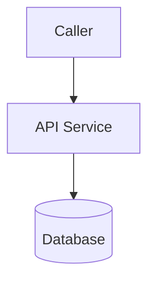

| Property | Value |
| :--- | :--- |
| Endpoints | 6 |
| Base path | `https://platform.nlproducts.net/o` |

## Architecture

## Endpoints

### GET `/nl-govcon-notification-rest/v1.0/sites/{siteId}/email-settings`

[Email] NlGovconNotificationRest.v1.0.getSiteEmailSettings

### POST `/nl-govcon-notification-rest/v1.0/sites/{siteId}/emails`

[Email] NlGovconNotificationRest.v1.0.postSiteEmail

### GET `/nl-govcon-notification-rest/v1.0/notifications`

[Notification] NlGovconNotificationRest.v1.0.getNotifications

### DELETE `/nl-govcon-notification-rest/v1.0/notifications/batch`

[Notification] NlGovconNotificationRest.v1.0.deleteNotificationBatch

### DELETE `/nl-govcon-notification-rest/v1.0/notifications/{notificationId}`

[Notification] NlGovconNotificationRest.v1.0.deleteNotification

### PUT `/nl-govcon-notification-rest/v1.0/notifications/{notificationId}/read`

[Notification] NlGovconNotificationRest.v1.0.markNotificationRead
