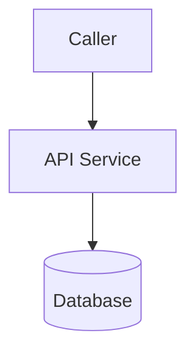

| Property | Value |
| :--- | :--- |
| Endpoints | 15 |
| Base path | `https://platform.nlproducts.net/o` |

## Architecture

## Endpoints

### GET `/nl-keycloak-client-rest/v1.0/realms/{realmName}/clients`

[Client] NlKeycloakClientRest.v1.0.getRealmClients

### POST `/nl-keycloak-client-rest/v1.0/realms/{realmName}/clients`

[Client] NlKeycloakClientRest.v1.0.createRealmClient

### DELETE `/nl-keycloak-client-rest/v1.0/realms/{realmName}/clients/{clientId}`

[Client] NlKeycloakClientRest.v1.0.deleteRealmClient

### GET `/nl-keycloak-client-rest/v1.0/realms/{realmName}/clients/{clientId}`

[Client] NlKeycloakClientRest.v1.0.getRealmClient

### PUT `/nl-keycloak-client-rest/v1.0/realms/{realmName}/clients/{clientId}`

[Client] NlKeycloakClientRest.v1.0.updateRealmClient

### GET `/nl-keycloak-client-rest/v1.0/realms/{realmName}/clients/{clientId}/offline-session-count`

[Client] NlKeycloakClientRest.v1.0.getClientOfflineSessionCount

### GET `/nl-keycloak-client-rest/v1.0/realms/{realmName}/clients/{clientId}/roles`

[Client] NlKeycloakClientRest.v1.0.getClientRoles

### POST `/nl-keycloak-client-rest/v1.0/realms/{realmName}/clients/{clientId}/roles`

[Client] NlKeycloakClientRest.v1.0.createClientRole

### DELETE `/nl-keycloak-client-rest/v1.0/realms/{realmName}/clients/{clientId}/roles/{roleName}`

[Client] NlKeycloakClientRest.v1.0.deleteClientRole

### GET `/nl-keycloak-client-rest/v1.0/realms/{realmName}/clients/{clientId}/roles/{roleName}`

[Client] NlKeycloakClientRest.v1.0.getClientRole

### PUT `/nl-keycloak-client-rest/v1.0/realms/{realmName}/clients/{clientId}/roles/{roleName}`

[Client] NlKeycloakClientRest.v1.0.updateClientRole

### POST `/nl-keycloak-client-rest/v1.0/realms/{realmName}/clients/{clientId}/rotate-secret`

[Client] NlKeycloakClientRest.v1.0.rotateClientSecret

### GET `/nl-keycloak-client-rest/v1.0/realms/{realmName}/clients/{clientId}/secret`

[Client] NlKeycloakClientRest.v1.0.getClientSecret

### GET `/nl-keycloak-client-rest/v1.0/realms/{realmName}/clients/{clientId}/service-account-user`

[Client] NlKeycloakClientRest.v1.0.getServiceAccountUser

### GET `/nl-keycloak-client-rest/v1.0/realms/{realmName}/clients/{clientId}/session-count`

[Client] NlKeycloakClientRest.v1.0.getClientSessionCount
