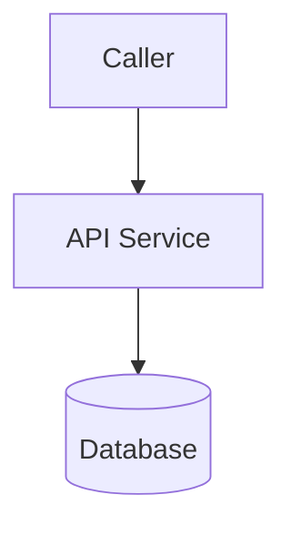

| Property | Value |
| :--- | :--- |
| Endpoints | 3 |
| Base path | `https://platform.nlproducts.net/o` |

## Architecture

## Endpoints

### GET `/nl-keycloak-oidc-rest/v1.0/companies/{companyId}/realms/{realmId}/connection`

[OidcConnection] NlKeycloakOidcRest.v1.0.getConnection

### PUT `/nl-keycloak-oidc-rest/v1.0/companies/{companyId}/realms/{realmId}/connection`

[OidcConnection] NlKeycloakOidcRest.v1.0.putConnection

### POST `/nl-keycloak-oidc-rest/v1.0/companies/{companyId}/realms/{realmId}/connection/verify`

[OidcConnection] NlKeycloakOidcRest.v1.0.postConnectionVerify
