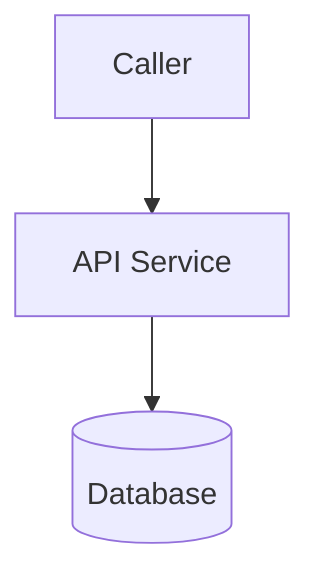

| Property | Value |
| :--- | :--- |
| Endpoints | 15 |
| Base path | `https://platform.nlproducts.net/o` |

## Architecture

## Endpoints

### PUT `/nl-keycloak-realm-rest/v1.0/realms/{realmName}/branding`

[Branding] NlKeycloakRealmRest.v1.0.updateRealmBranding

### GET `/nl-keycloak-realm-rest/v1.0/realms/{realmName}/identity-providers`

[IdentityProvider] NlKeycloakRealmRest.v1.0.getIdentityProviders

### PUT `/nl-keycloak-realm-rest/v1.0/realms/{realmName}/identity-providers/display-order`

[IdentityProvider] NlKeycloakRealmRest.v1.0.updateIdentityProviderDisplayOrder

### POST `/nl-keycloak-realm-rest/v1.0/realms/{realmName}/identity-providers/oidc`

[IdentityProvider] NlKeycloakRealmRest.v1.0.createOidcIdentityProvider

### POST `/nl-keycloak-realm-rest/v1.0/realms/{realmName}/identity-providers/saml`

[IdentityProvider] NlKeycloakRealmRest.v1.0.createSamlIdentityProvider

### DELETE `/nl-keycloak-realm-rest/v1.0/realms/{realmName}/identity-providers/{alias}`

[IdentityProvider] NlKeycloakRealmRest.v1.0.deleteIdentityProvider

### GET `/nl-keycloak-realm-rest/v1.0/realms/{realmName}/identity-providers/{alias}`

[IdentityProvider] NlKeycloakRealmRest.v1.0.getIdentityProvider

### PUT `/nl-keycloak-realm-rest/v1.0/realms/{realmName}/identity-providers/{alias}`

[IdentityProvider] NlKeycloakRealmRest.v1.0.updateIdentityProvider

### DELETE `/nl-keycloak-realm-rest/v1.0/realms/{realmName}/identity-providers/{alias}/batch`

[IdentityProvider] NlKeycloakRealmRest.v1.0.deleteIdentityProviderBatch

### GET `/nl-keycloak-realm-rest/v1.0/realms/{realmName}/identity-providers/{alias}/redirect-uri`

[IdentityProvider] NlKeycloakRealmRest.v1.0.getIdentityProviderRedirectUri

### POST `/nl-keycloak-realm-rest/v1.0/realms/{realmName}/identity-providers/{alias}/test`

[IdentityProvider] NlKeycloakRealmRest.v1.0.testIdentityProviderConnection

### GET `/nl-keycloak-realm-rest/v1.0/realms`

[Realm] NlKeycloakRealmRest.v1.0.getRealms

### POST `/nl-keycloak-realm-rest/v1.0/realms`

[Realm] NlKeycloakRealmRest.v1.0.createRealm

### DELETE `/nl-keycloak-realm-rest/v1.0/realms/{realmName}`

[Realm] NlKeycloakRealmRest.v1.0.deleteRealm

### GET `/nl-keycloak-realm-rest/v1.0/realms/{realmName}`

[Realm] NlKeycloakRealmRest.v1.0.getRealm
