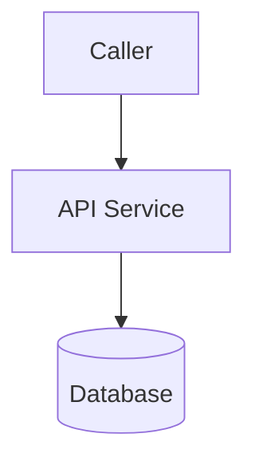

| Property | Value |
| :--- | :--- |
| Endpoints | 15 |
| Base path | `https://platform.nlproducts.net/o` |

## Architecture

## Endpoints

### GET `/nl-keycloak-user-rest/v1.0/realms/{realmName}/users`

[User] NlKeycloakUserRest.v1.0.searchRealmUsers

### POST `/nl-keycloak-user-rest/v1.0/realms/{realmName}/users`

[User] NlKeycloakUserRest.v1.0.createRealmUser

### POST `/nl-keycloak-user-rest/v1.0/realms/{realmName}/users/bulk`

[User] NlKeycloakUserRest.v1.0.createRealmUsers

### PUT `/nl-keycloak-user-rest/v1.0/realms/{realmName}/users/disable`

[User] NlKeycloakUserRest.v1.0.disableRealmUsers

### PUT `/nl-keycloak-user-rest/v1.0/realms/{realmName}/users/enable`

[User] NlKeycloakUserRest.v1.0.enableRealmUsers

### PUT `/nl-keycloak-user-rest/v1.0/realms/{realmName}/users/unverify-email`

[User] NlKeycloakUserRest.v1.0.markEmailsUnverified

### PUT `/nl-keycloak-user-rest/v1.0/realms/{realmName}/users/verify-email`

[User] NlKeycloakUserRest.v1.0.markEmailsVerified

### DELETE `/nl-keycloak-user-rest/v1.0/realms/{realmName}/users/{userId}`

[User] NlKeycloakUserRest.v1.0.deleteRealmUser

### GET `/nl-keycloak-user-rest/v1.0/realms/{realmName}/users/{userId}`

[User] NlKeycloakUserRest.v1.0.getRealmUser

### PUT `/nl-keycloak-user-rest/v1.0/realms/{realmName}/users/{userId}`

[User] NlKeycloakUserRest.v1.0.updateRealmUser

### DELETE `/nl-keycloak-user-rest/v1.0/realms/{realmName}/users/{userId}/groups/{groupId}`

[User] NlKeycloakUserRest.v1.0.removeUserGroup

### PUT `/nl-keycloak-user-rest/v1.0/realms/{realmName}/users/{userId}/groups/{groupId}`

[User] NlKeycloakUserRest.v1.0.assignUserGroup

### PUT `/nl-keycloak-user-rest/v1.0/realms/{realmName}/users/{userId}/reset-password`

[User] NlKeycloakUserRest.v1.0.resetUserPassword

### DELETE `/nl-keycloak-user-rest/v1.0/realms/{realmName}/users/{userId}/roles`

[User] NlKeycloakUserRest.v1.0.removeUserRoles

### POST `/nl-keycloak-user-rest/v1.0/realms/{realmName}/users/{userId}/roles`

[User] NlKeycloakUserRest.v1.0.assignUserRoles
