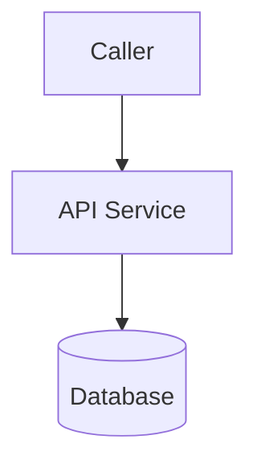

| Property | Value |
| :--- | :--- |
| Endpoints | 5 |
| Base path | `https://platform.nlproducts.net/o` |

## Architecture

## Endpoints

### GET `/nl-kubernetes-ingress-rest/v1.0/hosts`

[Host] NlKubernetesIngressRest.v1.0.getHosts

### POST `/nl-kubernetes-ingress-rest/v1.0/hosts`

[Host] NlKubernetesIngressRest.v1.0.addHost

### DELETE `/nl-kubernetes-ingress-rest/v1.0/hosts/{domain}`

[Host] NlKubernetesIngressRest.v1.0.deleteHost

### DELETE `/nl-kubernetes-ingress-rest/v1.0/hosts/{domain}/batch`

[Host] NlKubernetesIngressRest.v1.0.deleteHostBatch

### POST `/nl-kubernetes-ingress-rest/v1.0/sync`

[Host] NlKubernetesIngressRest.v1.0.triggerLiferayHostSync
