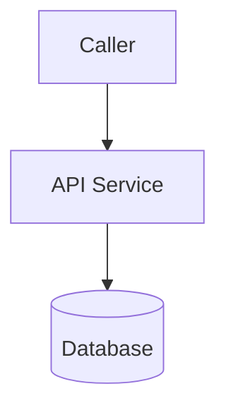

| Property | Value |
| :--- | :--- |
| Endpoints | 15 |
| Base path | `https://platform.nlproducts.net/o` |

## Architecture

## Endpoints

### GET `/nl-lead-finder/v1.0/dashboard/counts`

[Lead] NlLeadFinder.v1.0.getLeadProspectorCounts

### GET `/nl-lead-finder/v1.0/leads/capabilities`

[Lead] NlLeadFinder.v1.0.getLeadCapabilities

### POST `/nl-lead-finder/v1.0/leads/procurement-search`

[Lead] NlLeadFinder.v1.0.postLeadProcurementSearch

### POST `/nl-lead-finder/v1.0/leads/recompete-search`

[Lead] NlLeadFinder.v1.0.postLeadRecompeteSearch

### POST `/nl-lead-finder/v1.0/leads/samgov-search`

[Lead] NlLeadFinder.v1.0.postLeadSamGovSearch

### POST `/nl-lead-finder/v1.0/leads/search`

[Lead] NlLeadFinder.v1.0.postLeadSearch

### GET `/nl-lead-finder/v1.0/leads/{leadId}`

[Lead] NlLeadFinder.v1.0.getLead

### GET `/nl-lead-finder/v1.0/leads/workspace/facets`

[LeadWorkspace] NlLeadFinder.v1.0.getLeadWorkspaceFacets

### GET `/nl-lead-finder/v1.0/leads/workspace/groups`

[LeadWorkspace] NlLeadFinder.v1.0.getLeadWorkspaceGroups

### POST `/nl-lead-finder/v1.0/leads/workspace/groups/{groupId}/items`

[LeadWorkspace] NlLeadFinder.v1.0.getLeadWorkspaceGroupItems

### POST `/nl-lead-finder/v1.0/leads/workspace/items`

[LeadWorkspace] NlLeadFinder.v1.0.postLeadWorkspaceItem

### POST `/nl-lead-finder/v1.0/leads/workspace/items/exists`

[LeadWorkspace] NlLeadFinder.v1.0.postLeadWorkspaceItemsExists

### POST `/nl-lead-finder/v1.0/leads/workspace/items/move`

[LeadWorkspace] NlLeadFinder.v1.0.postLeadWorkspaceItemsMove

### DELETE `/nl-lead-finder/v1.0/leads/workspace/items/{itemId}`

[LeadWorkspace] NlLeadFinder.v1.0.deleteLeadWorkspaceItem

### GET `/nl-lead-finder/v1.0/leads/workspace/items/{itemId}`

[LeadWorkspace] NlLeadFinder.v1.0.getLeadWorkspaceItem
