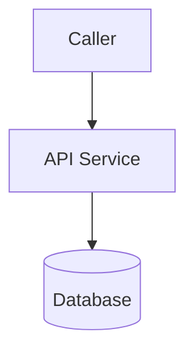

| Property | Value |
| :--- | :--- |
| Endpoints | 9 |
| Base path | `https://platform.nlproducts.net/o` |

## Architecture

## Endpoints

### GET `/nl-lead-prospector-configuration-rest/v1.0/ai-setting/{uei}`

[AISetting] NlLeadProspectorConfigurationRest.v1.0.getAISetting

### POST `/nl-lead-prospector-configuration-rest/v1.0/ai-setting/{uei}`

[AISetting] NlLeadProspectorConfigurationRest.v1.0.postAiSetting

### GET `/nl-lead-prospector-configuration-rest/v1.0/ebuy-config/{uei}`

[Ebuy] NlLeadProspectorConfigurationRest.v1.0.getEBuyConfig

### POST `/nl-lead-prospector-configuration-rest/v1.0/ebuy-config/{uei}`

[Ebuy] NlLeadProspectorConfigurationRest.v1.0.postEBuyConfig

### GET `/nl-lead-prospector-configuration-rest/v1.0/email-parser-config/{uei}`

[EmailParser] NlLeadProspectorConfigurationRest.v1.0.getEmailParserConfig

### POST `/nl-lead-prospector-configuration-rest/v1.0/email-parser-config/{uei}`

[EmailParser] NlLeadProspectorConfigurationRest.v1.0.postEmailParserConfig

### DELETE `/nl-lead-prospector-configuration-rest/v1.0/email-parser-config/{uei}/{id}`

[EmailParser] NlLeadProspectorConfigurationRest.v1.0.deleteEmailParserContract

### GET `/nl-lead-prospector-configuration-rest/v1.0/symphony/{uei}`

[Symphony] NlLeadProspectorConfigurationRest.v1.0.getSymphonyConfig

### POST `/nl-lead-prospector-configuration-rest/v1.0/symphony/{uei}`

[Symphony] NlLeadProspectorConfigurationRest.v1.0.postSymphonyConfig
