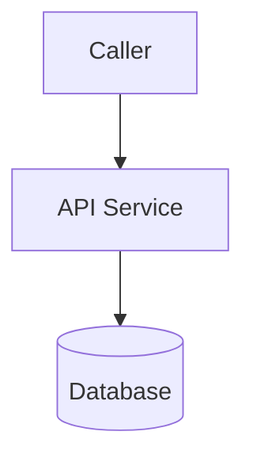

| Property | Value |
| :--- | :--- |
| Endpoints | 15 |
| Base path | `https://platform.nlproducts.net/o` |

## Architecture

## Endpoints

### GET `/nl-marketing-accelerator/v1.0/analytics/reports/{endpoint}`

[Analytics] NlMarketingAccelerator.v1.0.getAnalyticsData

### GET `/nl-marketing-accelerator/v1.0/api/sites/{siteId}/site-pages/{layoutId}/custom-meta`

[CustomMeta] NlMarketingAccelerator.v1.0.getCustomMetaTags

### POST `/nl-marketing-accelerator/v1.0/api/sites/{siteId}/site-pages/{layoutId}/custom-meta`

[CustomMeta] NlMarketingAccelerator.v1.0.postCustomMetaTag

### PUT `/nl-marketing-accelerator/v1.0/api/sites/{siteId}/site-pages/{layoutId}/custom-meta`

[CustomMeta] NlMarketingAccelerator.v1.0.putCustomMetaTags

### DELETE `/nl-marketing-accelerator/v1.0/api/sites/{siteId}/site-pages/{layoutId}/custom-meta/{metaTagId}`

[CustomMeta] NlMarketingAccelerator.v1.0.deleteCustomMetaTag

### GET `/nl-marketing-accelerator/v1.0/api/sites/{siteId}/site-pages/{layoutId}/friendly-url`

[FriendlyURL] NlMarketingAccelerator.v1.0.getFriendlyURL

### PUT `/nl-marketing-accelerator/v1.0/api/sites/{siteId}/site-pages/{layoutId}/friendly-url`

[FriendlyURL] NlMarketingAccelerator.v1.0.putFriendlyURL

### PUT `/nl-marketing-accelerator/v1.0/api/sites/{siteId}/site-pages/{layoutId}/friendly-url/batch`

[FriendlyURL] NlMarketingAccelerator.v1.0.putFriendlyURLBatch

### GET `/nl-marketing-accelerator/v1.0/api/sites/{siteId}/site-pages/{layoutId}/opengraph`

[OpenGraph] NlMarketingAccelerator.v1.0.getOpenGraph

### PUT `/nl-marketing-accelerator/v1.0/api/sites/{siteId}/site-pages/{layoutId}/opengraph`

[OpenGraph] NlMarketingAccelerator.v1.0.putOpenGraph

### PUT `/nl-marketing-accelerator/v1.0/api/sites/{siteId}/site-pages/{layoutId}/opengraph/batch`

[OpenGraph] NlMarketingAccelerator.v1.0.putOpenGraphBatch

### POST `/nl-marketing-accelerator/v1.0/page-analyzer/analyze`

[PageAnalyzer] NlMarketingAccelerator.v1.0.analyzePages

### GET `/nl-marketing-accelerator/v1.0/page-analyzer/analyze/check/status/{jobId}`

[PageAnalyzer] NlMarketingAccelerator.v1.0.checkJobStatus

### POST `/nl-marketing-accelerator/v1.0/api/sites/{siteId}/site-pages/copy-page`

[PageMetadata] NlMarketingAccelerator.v1.0.copyPage

### POST `/nl-marketing-accelerator/v1.0/api/sites/{siteId}/site-pages/propogate-configuration`

[PageMetadata] NlMarketingAccelerator.v1.0.propogateConfiguration
