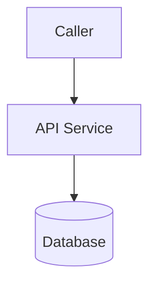

| Property | Value |
| :--- | :--- |
| Endpoints | 11 |
| Base path | `https://platform.nlproducts.net/o` |

## Architecture

## Endpoints

### GET `/nl-procurement-notices/v1.0/notice/{procurementNoticeId}/competitors`

[ProcurementNotice] NlProcurementNotices.v1.0.getProcurementNoticeCompetitors

### GET `/nl-procurement-notices/v1.0/notice/{procurementNoticeId}/detail`

[ProcurementNotice] NlProcurementNotices.v1.0.getProcurementNoticeDetail

### POST `/nl-procurement-notices/v1.0/notices`

[ProcurementNotice] NlProcurementNotices.v1.0.postProcurementNotice

### DELETE `/nl-procurement-notices/v1.0/notices/batch`

[ProcurementNotice] NlProcurementNotices.v1.0.deleteProcurementNoticeBatch

### POST `/nl-procurement-notices/v1.0/notices/batch`

[ProcurementNotice] NlProcurementNotices.v1.0.postProcurementNoticeBatch

### POST `/nl-procurement-notices/v1.0/notices/batch-sync`

[ProcurementNotice] NlProcurementNotices.v1.0.postProcurementNoticeBatchSync

### GET `/nl-procurement-notices/v1.0/notices/reference`

[ProcurementNotice] NlProcurementNotices.v1.0.getProcurementNoticeByReference

### POST `/nl-procurement-notices/v1.0/notices/search`

[ProcurementNotice] NlProcurementNotices.v1.0.postProcurementNoticeSearch

### DELETE `/nl-procurement-notices/v1.0/notices/{procurementNoticeId}`

[ProcurementNotice] NlProcurementNotices.v1.0.deleteProcurementNotice

### GET `/nl-procurement-notices/v1.0/notices/{procurementNoticeId}`

[ProcurementNotice] NlProcurementNotices.v1.0.getProcurementNotice

### POST `/nl-procurement-notices/v1.0/taskorder/files`

[ProcurementNotice] NlProcurementNotices.v1.0.postProcurementNoticeFiles
