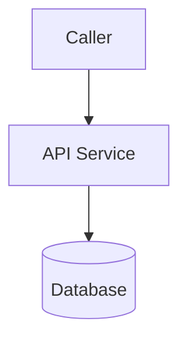

| Property | Value |
| :--- | :--- |
| Endpoints | 10 |
| Base path | `https://platform.nlproducts.net/o` |

## Architecture

## Endpoints

### POST `/nl-recompetes/v1.0/recompetes`

[Recompete] NlRecompetes.v1.0.postRecompete

### DELETE `/nl-recompetes/v1.0/recompetes/batch`

[Recompete] NlRecompetes.v1.0.deleteRecompeteBatch

### POST `/nl-recompetes/v1.0/recompetes/batch`

[Recompete] NlRecompetes.v1.0.postRecompeteBatch

### POST `/nl-recompetes/v1.0/recompetes/batch-sync`

[Recompete] NlRecompetes.v1.0.postRecompeteBatchSync

### POST `/nl-recompetes/v1.0/recompetes/existence`

[Recompete] NlRecompetes.v1.0.postRecompeteExistence

### POST `/nl-recompetes/v1.0/recompetes/processing-search`

[Recompete] NlRecompetes.v1.0.postRecompeteProcessingSearch

### GET `/nl-recompetes/v1.0/recompetes/reference`

[Recompete] NlRecompetes.v1.0.getRecompeteByReference

### POST `/nl-recompetes/v1.0/recompetes/search`

[Recompete] NlRecompetes.v1.0.postRecompeteSearch

### DELETE `/nl-recompetes/v1.0/recompetes/{recompeteId}`

[Recompete] NlRecompetes.v1.0.deleteRecompete

### GET `/nl-recompetes/v1.0/recompetes/{recompeteId}`

[Recompete] NlRecompetes.v1.0.getRecompete
