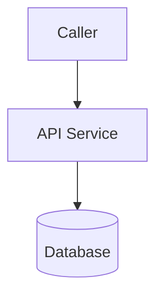

| Property | Value |
| :--- | :--- |
| Endpoints | 9 |
| Base path | `https://platform.nlproducts.net/o` |

## Architecture

## Endpoints

### POST `/nl-sam-gov/v1.0/solicitations`

[SamGovSolicitation] NlSamGov.v1.0.postSamGovSolicitation

### DELETE `/nl-sam-gov/v1.0/solicitations/batch`

[SamGovSolicitation] NlSamGov.v1.0.deleteSamGovSolicitationBatch

### POST `/nl-sam-gov/v1.0/solicitations/batch`

[SamGovSolicitation] NlSamGov.v1.0.postSamGovSolicitationBatch

### POST `/nl-sam-gov/v1.0/solicitations/existence`

[SamGovSolicitation] NlSamGov.v1.0.postSamGovSolicitationExistence

### POST `/nl-sam-gov/v1.0/solicitations/processing-search`

[SamGovSolicitation] NlSamGov.v1.0.postSamGovSolicitationProcessingSearch

### GET `/nl-sam-gov/v1.0/solicitations/reference`

[SamGovSolicitation] NlSamGov.v1.0.getSamGovSolicitationByReference

### POST `/nl-sam-gov/v1.0/solicitations/search`

[SamGovSolicitation] NlSamGov.v1.0.postSamGovSolicitationSearch

### DELETE `/nl-sam-gov/v1.0/solicitations/{samGovSolicitationId}`

[SamGovSolicitation] NlSamGov.v1.0.deleteSamGovSolicitation

### GET `/nl-sam-gov/v1.0/solicitations/{samGovSolicitationId}`

[SamGovSolicitation] NlSamGov.v1.0.getSamGovSolicitation
