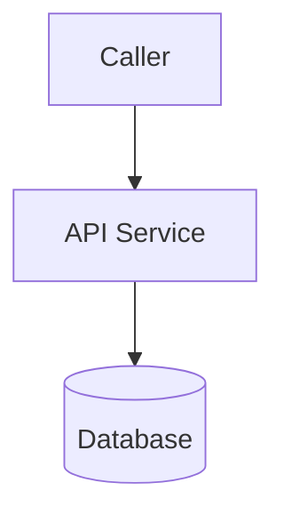

| Property | Value |
| :--- | :--- |
| Endpoints | 12 |
| Base path | `https://platform.nlproducts.net/o` |

## Architecture

## Endpoints

### GET `/nl-sso-provisioning-rest/v1.0/sso`

[SsoConfiguration] NlSsoProvisioningRest.v1.0.getSsoConfiguration

### PUT `/nl-sso-provisioning-rest/v1.0/sso/settings`

[SsoConfiguration] NlSsoProvisioningRest.v1.0.putSsoSettings

### GET `/nl-sso-provisioning-rest/v1.0/sso/identity-providers`

[SsoIdentityProvider] NlSsoProvisioningRest.v1.0.getSsoIdentityProviders

### POST `/nl-sso-provisioning-rest/v1.0/sso/identity-providers/oidc`

[SsoIdentityProvider] NlSsoProvisioningRest.v1.0.postOidcSsoIdentityProvider

### POST `/nl-sso-provisioning-rest/v1.0/sso/identity-providers/saml`

[SsoIdentityProvider] NlSsoProvisioningRest.v1.0.postSamlSsoIdentityProvider

### DELETE `/nl-sso-provisioning-rest/v1.0/sso/identity-providers/{alias}`

[SsoIdentityProvider] NlSsoProvisioningRest.v1.0.deleteSsoIdentityProvider

### GET `/nl-sso-provisioning-rest/v1.0/sso/identity-providers/{alias}`

[SsoIdentityProvider] NlSsoProvisioningRest.v1.0.getSsoIdentityProvider

### PUT `/nl-sso-provisioning-rest/v1.0/sso/identity-providers/{alias}`

[SsoIdentityProvider] NlSsoProvisioningRest.v1.0.putSsoIdentityProvider

### DELETE `/nl-sso-provisioning-rest/v1.0/sso/identity-providers/{alias}/batch`

[SsoIdentityProvider] NlSsoProvisioningRest.v1.0.deleteSsoIdentityProviderBatch

### PUT `/nl-sso-provisioning-rest/v1.0/sso/identity-providers/{alias}/batch`

[SsoIdentityProvider] NlSsoProvisioningRest.v1.0.putSsoIdentityProviderBatch

### GET `/nl-sso-provisioning-rest/v1.0/sso/identity-providers/{alias}/redirect-uri`

[SsoIdentityProvider] NlSsoProvisioningRest.v1.0.getSsoIdentityProviderRedirectUri

### POST `/nl-sso-provisioning-rest/v1.0/sso/identity-providers/{alias}/test`

[SsoIdentityProvider] NlSsoProvisioningRest.v1.0.postSsoIdentityProviderTest
