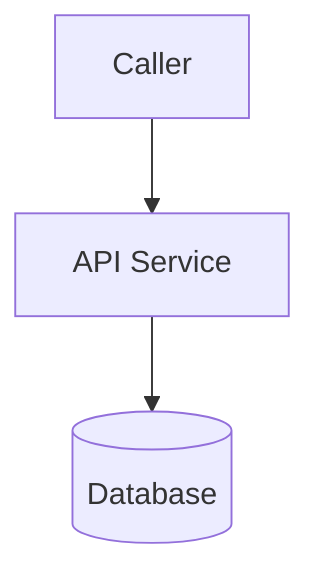

| Property | Value |
| :--- | :--- |
| Endpoints | 15 |
| Base path | `https://platform.nlproducts.net/o` |

## Architecture

## Endpoints

### GET `/nl-user-provisioning-rest/v1.0/companies/{companyId}/capacity`

[ManagedUser] NlUserProvisioningRest.v1.0.getCompanyUserCapacity

### POST `/nl-user-provisioning-rest/v1.0/invitations`

[ManagedUser] NlUserProvisioningRest.v1.0.postInvitation

### POST `/nl-user-provisioning-rest/v1.0/invitations/{keycloakUserId}/resend`

[ManagedUser] NlUserProvisioningRest.v1.0.postInvitationResend

### POST `/nl-user-provisioning-rest/v1.0/invitations/{keycloakUserId}/revoke`

[ManagedUser] NlUserProvisioningRest.v1.0.postInvitationRevoke

### GET `/nl-user-provisioning-rest/v1.0/usernames/availability`

[ManagedUser] NlUserProvisioningRest.v1.0.getUsernameAvailability

### GET `/nl-user-provisioning-rest/v1.0/users`

[ManagedUser] NlUserProvisioningRest.v1.0.getUsersPage

### POST `/nl-user-provisioning-rest/v1.0/users`

[ManagedUser] NlUserProvisioningRest.v1.0.postUser

### POST `/nl-user-provisioning-rest/v1.0/users/bulk`

[ManagedUser] NlUserProvisioningRest.v1.0.postUsersBulk

### PUT `/nl-user-provisioning-rest/v1.0/users/me/password`

[ManagedUser] NlUserProvisioningRest.v1.0.putMyPassword

### GET `/nl-user-provisioning-rest/v1.0/users/{userId}`

[ManagedUser] NlUserProvisioningRest.v1.0.getUser

### PATCH `/nl-user-provisioning-rest/v1.0/users/{userId}`

[ManagedUser] NlUserProvisioningRest.v1.0.patchUser

### POST `/nl-user-provisioning-rest/v1.0/users/{userId}/deactivate`

[ManagedUser] NlUserProvisioningRest.v1.0.postUserDeactivate

### POST `/nl-user-provisioning-rest/v1.0/users/{userId}/password/reset`

[ManagedUser] NlUserProvisioningRest.v1.0.postUserPasswordReset

### POST `/nl-user-provisioning-rest/v1.0/users/{userId}/reactivate`

[ManagedUser] NlUserProvisioningRest.v1.0.postUserReactivate

### PUT `/nl-user-provisioning-rest/v1.0/users/{userId}/roles`

[ManagedUser] NlUserProvisioningRest.v1.0.putUserRoles
