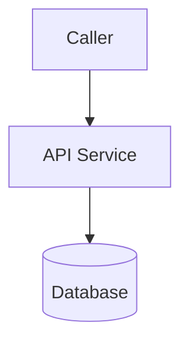

| Property | Value |
| :--- | :--- |
| Endpoints | 3 |
| Base path | `https://platform.nlproducts.net/o` |

## Architecture

## Endpoints

### PUT `/nl-virtual-assistant/v1.0/api/sites/{siteId}/global-js`

[GlobalJS] NlVirtualAssistant.v1.0.putGlobalJSForSite

### PUT `/nl-virtual-assistant/v1.0/api/sites/{siteId}/site-pages/{layoutId}/global-js`

[GlobalJS] NlVirtualAssistant.v1.0.putGlobalJSForPage

### POST `/nl-virtual-assistant/v1.0/api/sites/{siteId}/site-pages`

[Pages] NlVirtualAssistant.v1.0.postCreateWidgetPage
