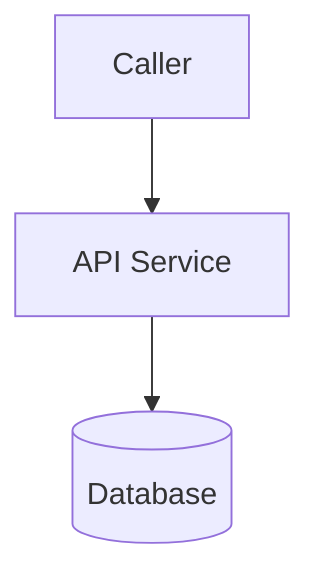

| Property | Value |
| :--- | :--- |
| Endpoints | 15 |
| Base path | `https://platform.nlproducts.net/o` |

## Architecture

## Endpoints

### GET `/notification/v1.0/notification-queue-entries`

[NotificationQueueEntry] Notification.v1.0.getNotificationQueueEntriesPage

### POST `/notification/v1.0/notification-queue-entries`

[NotificationQueueEntry] Notification.v1.0.postNotificationQueueEntry

### DELETE `/notification/v1.0/notification-queue-entries/batch`

[NotificationQueueEntry] Notification.v1.0.deleteNotificationQueueEntryBatch

### POST `/notification/v1.0/notification-queue-entries/batch`

[NotificationQueueEntry] Notification.v1.0.postNotificationQueueEntryBatch

### POST `/notification/v1.0/notification-queue-entries/export-batch`

[NotificationQueueEntry] Notification.v1.0.postNotificationQueueEntriesPageExportBatch

### DELETE `/notification/v1.0/notification-queue-entries/{notificationQueueEntryId}`

[NotificationQueueEntry] Notification.v1.0.deleteNotificationQueueEntry

### GET `/notification/v1.0/notification-queue-entries/{notificationQueueEntryId}`

[NotificationQueueEntry] Notification.v1.0.getNotificationQueueEntry

### PUT `/notification/v1.0/notification-queue-entries/{notificationQueueEntryId}/resend`

[NotificationQueueEntry] Notification.v1.0.putNotificationQueueEntryResend

### GET `/notification/v1.0/notification-templates`

[NotificationTemplate] Notification.v1.0.getNotificationTemplatesPage

### POST `/notification/v1.0/notification-templates`

[NotificationTemplate] Notification.v1.0.postNotificationTemplate

### DELETE `/notification/v1.0/notification-templates/batch`

[NotificationTemplate] Notification.v1.0.deleteNotificationTemplateBatch

### POST `/notification/v1.0/notification-templates/batch`

[NotificationTemplate] Notification.v1.0.postNotificationTemplateBatch

### PUT `/notification/v1.0/notification-templates/batch`

[NotificationTemplate] Notification.v1.0.putNotificationTemplateBatch

### GET `/notification/v1.0/notification-templates/by-external-reference-code/{externalReferenceCode}`

[NotificationTemplate] Notification.v1.0.getNotificationTemplateByExternalReferenceCode

### PUT `/notification/v1.0/notification-templates/by-external-reference-code/{externalReferenceCode}`

[NotificationTemplate] Notification.v1.0.putNotificationTemplateByExternalReferenceCode
