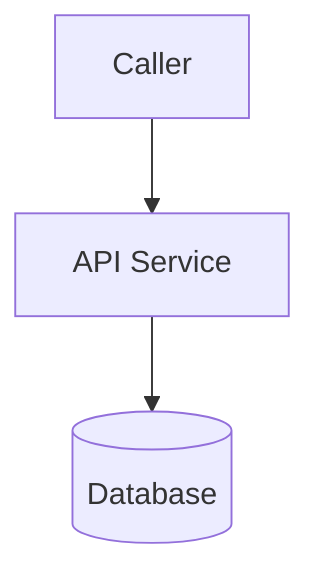

| Property | Value |
| :--- | :--- |
| Endpoints | 15 |
| Base path | `https://platform.nlproducts.net/o` |

## Architecture

## Endpoints

### DELETE `/object-admin/v1.0/object-actions/batch`

[ObjectAction] ObjectAdmin.v1.0.deleteObjectActionBatch

### PUT `/object-admin/v1.0/object-actions/batch`

[ObjectAction] ObjectAdmin.v1.0.putObjectActionBatch

### DELETE `/object-admin/v1.0/object-actions/{objectActionId}`

[ObjectAction] ObjectAdmin.v1.0.deleteObjectAction

### GET `/object-admin/v1.0/object-actions/{objectActionId}`

[ObjectAction] ObjectAdmin.v1.0.getObjectAction

### PATCH `/object-admin/v1.0/object-actions/{objectActionId}`

[ObjectAction] ObjectAdmin.v1.0.patchObjectAction

### PUT `/object-admin/v1.0/object-actions/{objectActionId}`

[ObjectAction] ObjectAdmin.v1.0.putObjectAction

### GET `/object-admin/v1.0/object-definitions/by-external-reference-code/{externalReferenceCode}/object-actions`

[ObjectAction] ObjectAdmin.v1.0.getObjectDefinitionByExternalReferenceCodeObjectActionsPage

### POST `/object-admin/v1.0/object-definitions/by-external-reference-code/{externalReferenceCode}/object-actions`

[ObjectAction] ObjectAdmin.v1.0.postObjectDefinitionByExternalReferenceCodeObjectAction

### GET `/object-admin/v1.0/object-definitions/{objectDefinitionId}/object-actions`

[ObjectAction] ObjectAdmin.v1.0.getObjectDefinitionObjectActionsPage

### POST `/object-admin/v1.0/object-definitions/{objectDefinitionId}/object-actions`

[ObjectAction] ObjectAdmin.v1.0.postObjectDefinitionObjectAction

### POST `/object-admin/v1.0/object-definitions/{objectDefinitionId}/object-actions/batch`

[ObjectAction] ObjectAdmin.v1.0.postObjectDefinitionObjectActionBatch

### POST `/object-admin/v1.0/object-definitions/{objectDefinitionId}/object-actions/export-batch`

[ObjectAction] ObjectAdmin.v1.0.postObjectDefinitionObjectActionsPageExportBatch

### GET `/object-admin/v1.0/object-definitions`

[ObjectDefinition] ObjectAdmin.v1.0.getObjectDefinitionsPage

### POST `/object-admin/v1.0/object-definitions`

[ObjectDefinition] ObjectAdmin.v1.0.postObjectDefinition

### DELETE `/object-admin/v1.0/object-definitions/batch`

[ObjectDefinition] ObjectAdmin.v1.0.deleteObjectDefinitionBatch
