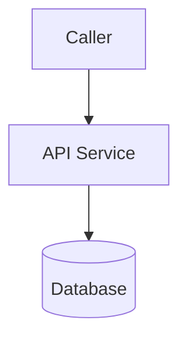

| Property | Value |
| :--- | :--- |
| Endpoints | 1 |
| Base path | `https://platform.nlproducts.net/o` |

## Architecture

## Endpoints

### GET `/provisioning-rest-services/v1.0/provisioning/account-management/account/exists/{uei}`

[AccountManagement] ProvisioningRestServices.v1.0.checkAccount
