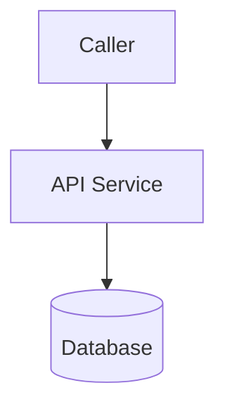

| Property | Value |
| :--- | :--- |
| Endpoints | 5 |
| Base path | `https://platform.nlproducts.net/o` |

## Architecture

## Endpoints

### GET `/search/v1.0/embeddings/embedding-models`

[EmbeddingModel] Search.v1.0.getEmbeddingEmbeddingModelsPage

### POST `/search/v1.0/embeddings/validate-provider-configuration`

[EmbeddingProviderValidationResult] Search.v1.0.postEmbeddingValidateProviderConfiguration

### GET `/search/v1.0/search`

[SearchResult] Search.v1.0.getSearchPage

### POST `/search/v1.0/search`

[SearchResult] Search.v1.0.postSearchPage

### POST `/search/v1.0/suggestions`

[Suggestion] Search.v1.0.postSuggestionsPage
