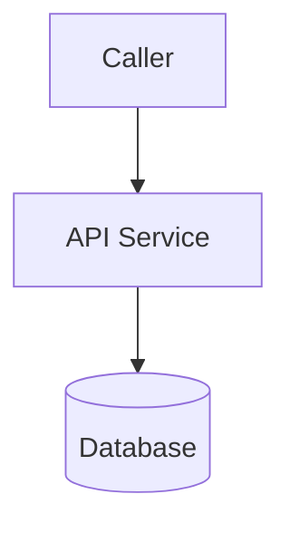

| Property | Value |
| :--- | :--- |
| Endpoints | 11 |
| Base path | `https://platform.nlproducts.net/o` |

## Architecture

## Endpoints

### POST `/test/v1.0/reserved-word`

[TestEntity] Test.v1.0.postReservedWord

### GET `/test/v1.0/test-entities`

[TestEntity] Test.v1.0.getTestEntitiesPage

### POST `/test/v1.0/test-entities`

[TestEntity] Test.v1.0.postTestEntity

### POST `/test/v1.0/test-entities/batch`

[TestEntity] Test.v1.0.postTestEntityBatch

### PUT `/test/v1.0/test-entities/batch`

[TestEntity] Test.v1.0.putTestEntityBatch

### GET `/test/v1.0/test-entities/count`

[TestEntity] Test.v1.0.getTestEntityCount

### POST `/test/v1.0/test-entities/export-batch`

[TestEntity] Test.v1.0.postTestEntitiesPageExportBatch

### GET `/test/v1.0/test-entities/{testEntityId}`

[TestEntity] Test.v1.0.getTestEntity

### PATCH `/test/v1.0/test-entities/{testEntityId}`

[TestEntity] Test.v1.0.patchTestEntity

### PUT `/test/v1.0/test-entities/{testEntityId}`

[TestEntity] Test.v1.0.putTestEntity

### GET `/test/v1.0/test-entities/{testEntityId}/test-entity-address`

[TestEntityAddress] Test.v1.0.getTestEntityTestEntityAddress
