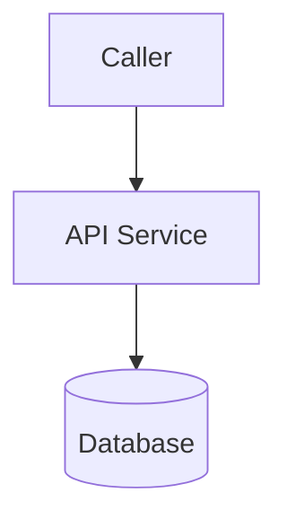

| Property | Value |
| :--- | :--- |
| Endpoints | 15 |
| Base path | `https://platform.nlproducts.net/o` |

## Architecture

## Endpoints

### GET `/c/accesslogs`

[CAccesslogs.AccessLog] CAccesslogs.getAccessLogsPage

### POST `/c/accesslogs`

[CAccesslogs.AccessLog] CAccesslogs.postAccessLog

### DELETE `/c/accesslogs/batch`

[CAccesslogs.AccessLog] CAccesslogs.deleteAccessLogBatch

### POST `/c/accesslogs/batch`

[CAccesslogs.AccessLog] CAccesslogs.postAccessLogBatch

### PUT `/c/accesslogs/batch`

[CAccesslogs.AccessLog] CAccesslogs.putAccessLogBatch

### DELETE `/c/accesslogs/by-external-reference-code/{externalReferenceCode}`

[CAccesslogs.AccessLog] CAccesslogs.deleteByExternalReferenceCode

### GET `/c/accesslogs/by-external-reference-code/{externalReferenceCode}`

[CAccesslogs.AccessLog] CAccesslogs.getByExternalReferenceCode

### PATCH `/c/accesslogs/by-external-reference-code/{externalReferenceCode}`

[CAccesslogs.AccessLog] CAccesslogs.patchByExternalReferenceCode

### PUT `/c/accesslogs/by-external-reference-code/{externalReferenceCode}`

[CAccesslogs.AccessLog] CAccesslogs.putByExternalReferenceCode

### POST `/c/accesslogs/export-batch`

[CAccesslogs.AccessLog] CAccesslogs.postAccessLogsPageExportBatch

### DELETE `/c/accesslogs/{accessLogId}`

[CAccesslogs.AccessLog] CAccesslogs.deleteAccessLog

### GET `/c/accesslogs/{accessLogId}`

[CAccesslogs.AccessLog] CAccesslogs.getAccessLog

### PATCH `/c/accesslogs/{accessLogId}`

[CAccesslogs.AccessLog] CAccesslogs.patchAccessLog

### PUT `/c/accesslogs/{accessLogId}`

[CAccesslogs.AccessLog] CAccesslogs.putAccessLog

### GET `/c/accesslogs/{accessLogId}/permissions`

[CAccesslogs.AccessLog] CAccesslogs.getAccessLogPermissionsPage
