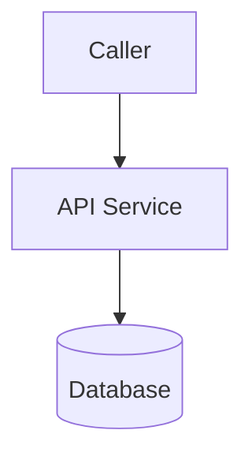

| Property | Value |
| :--- | :--- |
| Endpoints | 8 |
| Base path | `https://nl-govcon-agency-api-qa-internal.nlproducts.net` |

## Architecture

## Endpoints

### POST `/api/agency/v1/types`

Get distinct agency types

### POST `/api/agency/v1/people`

Get Vendor Contacts

### POST `/api/agency/v1/names`

Get distinct agency names

### POST `/api/agency/v1/hierarchy`

Get agency hierarchy with ancestors and immediate children

### POST `/api/agency/v1/agencies`

Get Agency details

### GET `/api/agency/v1/regional-locations`

Get regional locations for an agency

### GET `/api/agency/v1/detail`

Get agency detail by org_key

### GET `/api/agency/v1/budgetory-resource-obligation`

Get Agency Budgetory Resource obligation amount
