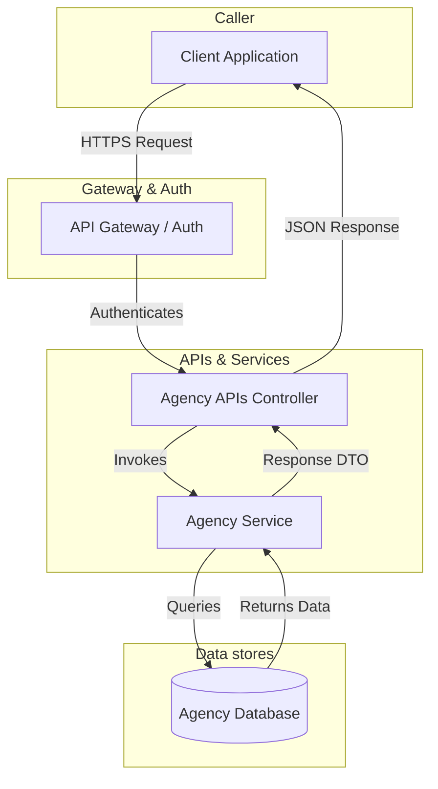

| Property | Value |
| :--- | :--- |
| Deployed as | GovCon API |
| Endpoints | 8 |
| Base path | `https://nl-govcon-agency-api-qa-internal.nlproducts.net` |

## Architecture



## Configuration

- Headers: standard authentication headers required for all endpoints (`Authorization: Bearer <token>`).
- Secrets: managed via environment-specific key vaults for internal service-to-service calls.

## Data

- `DataList`: Standard paginated response schema containing a list of records.
- `Wrapper`: Generic wrapper schema containing single-entity or aggregate resource objects.
- `PeopleSearchCriteria`: Request body schema for filtering vendor contacts.
- `AgencyInput`: Request body schema for searching agencies by type and active status.

## Endpoints

### POST /api/agency/v1/types

Get distinct agency types

Fetches a list of all unique agency types available in the Agency data.

#### Parameters

| Name | Location | Type | Required | Description |
| :--- | :--- | :--- | :--- | :--- |
| `page` | query | integer(int32) | Yes | Page number |
| `limit` | query | integer(int32) | Yes | Items per page |

#### Example Request

```json
{
  "page": 0,
  "limit": 10
}
```

#### Example Response (`200 OK`)

```json
{
  "content": [
    "Independent Agency",
    "Cabinet Department"
  ],
  "page": 0,
  "limit": 10,
  "totalElements": 2
}
```

---

### POST /api/agency/v1/people

Get Vendor Contacts

Get Vendors people data

#### Parameters

| Name | Location | Type | Required | Description |
| :--- | :--- | :--- | :--- | :--- |
| `page` | query | integer(int32) | Yes | Page number (0-based) |
| `limit` | query | integer(int32) | Yes | Items per page |

#### Example Request

```json
{
  "vendorName": "Acme Corp"
}
```

#### Example Response (`200 OK`)

```json
{
  "content": [
    {
      "contactId": "12345",
      "name": "Jane Doe",
      "email": "jane.doe@example.com"
    }
  ],
  "page": 0,
  "limit": 10,
  "totalElements": 1
}
```

---

### POST /api/agency/v1/names

Get distinct agency names

Fetches a list of all unique agency names present in the Agency data.

#### Parameters

| Name | Location | Type | Required | Description |
| :--- | :--- | :--- | :--- | :--- |
| `page` | query | integer(int32) | Yes | Page number |
| `limit` | query | integer(int32) | Yes | Items per page |

#### Example Request

```json
{
  "page": 0,
  "limit": 10
}
```

#### Example Response (`200 OK`)

```json
{
  "content": [
    "Department of Defense",
    "General Services Administration"
  ],
  "page": 0,
  "limit": 10,
  "totalElements": 2
}
```

---

### POST /api/agency/v1/hierarchy

Get agency hierarchy with ancestors and immediate children

Returns agency details along with its ancestors and immediate children for the given agency code.

#### Parameters

| Name | Location | Type | Required | Description |
| :--- | :--- | :--- | :--- | :--- |
| `org_key` | query | integer(int64) | Yes | Agency org_key |

#### Example Request

```json
{
  "org_key": 1001
}
```

#### Example Response (`200 OK`)

```json
{
  "content": {
    "orgKey": 1001,
    "name": "Department of Defense",
    "ancestors": [],
    "children": []
  }
}
```

---

### POST /api/agency/v1/agencies

Get Agency details

Search agencies using filters like agency type and active status

#### Parameters

| Name | Location | Type | Required | Description |
| :--- | :--- | :--- | :--- | :--- |
| `page` | query | integer(int32) | Yes | Page number |
| `limit` | query | integer(int32) | Yes | Items per page |

#### Example Request

```json
{
  "agencyType": "Cabinet Department",
  "activeStatus": true
}
```

#### Example Response (`200 OK`)

```json
{
  "content": [
    {
      "orgKey": 1001,
      "agencyName": "Department of Defense"
    }
  ],
  "page": 0,
  "limit": 10,
  "totalElements": 1
}
```

---

### GET /api/agency/v1/regional-locations

Get regional locations for an agency

Returns regional office locations (title, region, phone, address) for the given agency org_key.

#### Parameters

| Name | Location | Type | Required | Description |
| :--- | :--- | :--- | :--- | :--- |
| `org_key` | query | integer(int64) | Yes | Agency org_key |
| `page` | query | integer(int32) | No | Page number (0-based) |
| `limit` | query | integer(int32) | No | Items per page |

#### Example Response (`200 OK`)

```json
{
  "content": [
    {
      "title": "Regional Office East",
      "region": "Region 1",
      "phone": "555-0199",
      "address": "123 Federal Way"
    }
  ],
  "page": 0,
  "limit": 10,
  "totalElements": 1
}
```

---

### GET /api/agency/v1/detail

Get agency detail by org_key

Fetch a single agency detail wrapped in paginated format using org_key

#### Parameters

| Name | Location | Type | Required | Description |
| :--- | :--- | :--- | :--- | :--- |
| `org_key` | query | integer(int64) | Yes | Agency org_key |

#### Example Response (`200 OK`)

```json
{
  "content": [
    {
      "orgKey": 1001,
      "name": "Department of Defense",
      "code": "DOD"
    }
  ],
  "page": 0,
  "limit": 1,
  "totalElements": 1
}
```

---

### GET /api/agency/v1/budgetory-resource-obligation

Get Agency Budgetory Resource obligation amount

Returns Get Agency Budgetory Resource obligation amount.

#### Parameters

| Name | Location | Type | Required | Description |
| :--- | :--- | :--- | :--- | :--- |
| `org_key` | query | integer(int64) | Yes | Agency org_key |

#### Example Response (`200 OK`)

```json
{
  "data": {
    "orgKey": 1001,
    "obligationAmount": 500000000.00
  }
}
```
