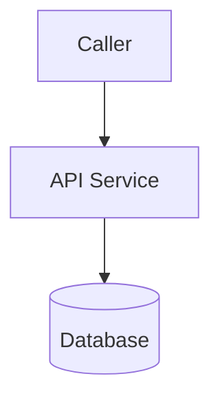

| Property | Value |
| :--- | :--- |
| Endpoints | 15 |
| Base path | `https://nl-govcon-agency-api-qa-internal.nlproducts.net` |

## Architecture

## Endpoints

### POST `/api/award/v1/subawards`

Search subawards (PG)

### POST `/api/award/v1/subaward-state-summary`

Get state summary for a subawardee UEI (subawards)

### POST `/api/award/v1/state-summary`

Get state summary for a recipient UEI (awards)

### POST `/api/award/v1/psc-summary`

Get PSC summary for a recipient

### POST `/api/award/v1/naics-summary`

Get NAICS summary for a recipient

### POST `/api/award/v1/awards`

Get award details

### POST `/api/award/v1/agency/vendors`

Get agencies vendor by org key

### POST `/api/award/v1/agency-code-summary`

Get code-wise obligation summary for an agency (PG)

### GET `/api/award/v1/yearly-obligation-by-parent`

Get year-wise total obligation for a parent award PIID i.e. contract_number

### GET `/api/award/v1/top/awards`

Get top awards

### GET `/api/award/v1/subawards/total-amount`

Get total subaward amount for a parent award PIID (PG)

### GET `/api/award/v1/recipient-unique-awards-summary`

Get unique award count and total obligation for a recipient

### GET `/api/award/v1/recipient-summary`

Get total award obligation and count for a recipient UEI

### GET `/api/award/v1/pop-timeline`

Get Period of Performance Timeline

### GET `/api/award/v1/location-summary`

Get location summary for a recipient
