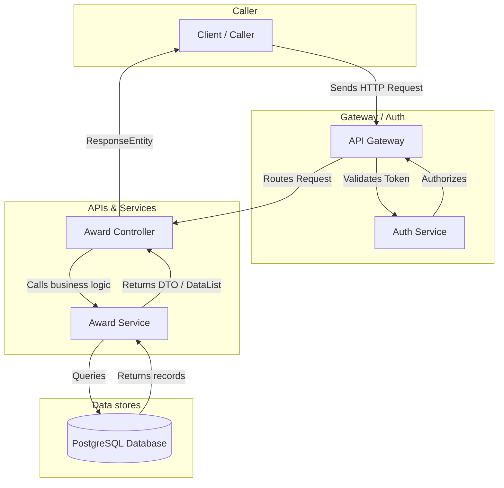

---
description: "API reference for GovCon Award APIs part 1 containing 15 endpoints."
---

| Property | Value |
| :--- | :--- |
| Deployed as | GovCon API |
| Endpoints | 15 |
| Base path | `https://nl-govcon-agency-api-qa-internal.nlproducts.net` |

:::note
This is Part 1 of 2 for the Award APIs reference. Additional endpoints and items continue in Part 2.
:::

## Architecture



## Configuration

- Headers: `Authorization: Bearer <token>`, `Content-Type: application/json`
- Secrets: Managed securely via environment-specific secrets stores for token validation.

## Data

- Schemas: `SubAwardInput`, `State`, `Psc`, `Naics`, `AwardInput`, `AgencyVendor`, `AgencyCode`, `DataList`, `Wrapper`

## Endpoints

### POST /api/award/v1/subawards

Search subawards (PG)

**Parameters**

| Name | Location | Type | Required | Description |
| :--- | :--- | :--- | :--- | :--- |
| `page` | query | integer(int32) | Yes | Page number |
| `limit` | query | integer(int32) | Yes | Items per page |

**Request**

```json
{
  "filters": {
    "agency": "Department of Defense"
  }
}
```

**Response**

```json
{
  "content": [
    {
      "subaward_id": "SUB-1001",
      "amount": 500000.00
    }
  ],
  "page": 1,
  "limit": 10
}
```

---

### POST /api/award/v1/subaward-state-summary

Get state summary for a subawardee UEI (subawards)

**Parameters**

| Name | Location | Type | Required | Description |
| :--- | :--- | :--- | :--- | :--- |
| `uei` | query | string | Yes | Subawardee UEI |
| `page` | query | integer(int32) | No | Page number |
| `limit` | query | integer(int32) | No | Items per page |

**Request**

```json
{
  "state_code": "VA"
}
```

**Response**

```json
{
  "content": [
    {
      "state": "Virginia",
      "total_obligated": 1250000.00
    }
  ]
}
```

---

### POST /api/award/v1/state-summary

Get state summary for a recipient UEI (awards)

**Parameters**

| Name | Location | Type | Required | Description |
| :--- | :--- | :--- | :--- | :--- |
| `uei` | query | string | Yes | Recipient UEI |
| `page` | query | integer(int32) | No | Page number |
| `limit` | query | integer(int32) | No | Items per page |

**Request**

```json
{
  "fiscal_year": 2023
}
```

**Response**

```json
{
  "content": [
    {
      "state": "MD",
      "total_amount": 3400000.00
    }
  ]
}
```

---

### POST /api/award/v1/psc-summary

Get PSC summary for a recipient

**Parameters**

| Name | Location | Type | Required | Description |
| :--- | :--- | :--- | :--- | :--- |
| `uei` | query | string | Yes | Recipient UEI |
| `page` | query | integer(int32) | No | Page number |
| `limit` | query | integer(int32) | No | Items per page |

**Request**

```json
{
  "code_group": "R425"
}
```

**Response**

```json
{
  "content": [
    {
      "psc_code": "R425",
      "description": "Support- Professional: Engineering/Technical",
      "total": 980000.00
    }
  ]
}
```

---

### POST /api/award/v1/naics-summary

Get NAICS summary for a recipient

**Parameters**

| Name | Location | Type | Required | Description |
| :--- | :--- | :--- | :--- | :--- |
| `uei` | query | string | Yes | Recipient UEI |
| `page` | query | integer(int32) | No | Page number |
| `limit` | query | integer(int32) | No | Items per page |

**Request**

```json
{
  "naics_code": "541512"
}
```

**Response**

```json
{
  "content": [
    {
      "naics_code": "541512",
      "description": "Computer Systems Design Services",
      "total": 4500000.00
    }
  ]
}
```

---

### POST /api/award/v1/awards

Get award details

Search awards using filters like NAICS, PSC, agency, etc.

**Parameters**

| Name | Location | Type | Required | Description |
| :--- | :--- | :--- | :--- | :--- |
| `page` | query | integer(int32) | Yes | Page number |
| `limit` | query | integer(int32) | Yes | Items per page |

**Request**

```json
{
  "naics_codes": ["541511", "541512"]
}
```

**Response**

```json
{
  "content": [
    {
      "award_id": "W911QX22C0012",
      "piid": "W911QX22C0012",
      "obligation": 150000.00
    }
  ],
  "page": 1,
  "limit": 10
}
```

---

### POST /api/award/v1/agency/vendors

Get agencies vendor by org key

**Parameters**

| Name | Location | Type | Required | Description |
| :--- | :--- | :--- | :--- | :--- |
| `org_key` | query | integer(int32) | Yes | Agency Org Key |
| `page` | query | integer(int32) | No | Page number |
| `limit` | query | integer(int32) | No | Items per page |

**Request**

```json
{
  "status": "active"
}
```

**Response**

```json
{
  "content": [
    {
      "vendor_name": "ACME CORP",
      "uei": "ABC123XYZ"
    }
  ]
}
```

---

### POST /api/award/v1/agency-code-summary

Get code-wise obligation summary for an agency (PG)

**Parameters**

| Name | Location | Type | Required | Description |
| :--- | :--- | :--- | :--- | :--- |
| `awarding_org_key` | query | integer(int32) | No | Awarding Agency Org Key |
| `funding_org_key` | query | integer(int32) | No | Funding Agency Org Key |
| `code_field` | query | string | Yes | Code field (e.g., naicsCode, productOrServiceCode, popStateCode) |
| `description_field` | query | string | No | Description field (e.g., naicsDescription, productOrServiceDescription) |
| `level` | query | integer(int32) | No | Level |
| `page` | query | integer(int32) | No | Page number |
| `limit` | query | integer(int32) | No | Items per page |

**Request**

```json
{
  "fiscal_year": 2022
}
```

**Response**

```json
{
  "content": [
    {
      "code": "5415",
      "obligation_total": 7500000.00
    }
  ]
}
```

---

### GET /api/award/v1/yearly-obligation-by-parent

Get year-wise total obligation for a parent award PIID i.e. contract_number

**Parameters**

| Name | Location | Type | Required | Description |
| :--- | :--- | :--- | :--- | :--- |
| `parent_award_pi_id` | query | string | Yes | Parent Award PIID |
| `page` | query | integer(int32) | No | Page number |
| `limit` | query | integer(int32) | No | Items per page |

**Response**

```json
{
  "content": [
    {
      "year": 2021,
      "obligation": 1200000.00
    },
    {
      "year": 2022,
      "obligation": 1500000.00
    }
  ]
}
```

---

### GET /api/award/v1/top/awards

Get top awards

**Parameters**

| Name | Location | Type | Required | Description |
| :--- | :--- | :--- | :--- | :--- |
| `uei` | query | string | Yes | recipient uei |

**Response**

```json
{
  "data": [
    {
      "award_id": "GS00F1234N",
      "total_value": 5000000.00
    }
  ]
}
```

---

### GET /api/award/v1/subawards/total-amount

Get total subaward amount for a parent award PIID (PG)

**Parameters**

| Name | Location | Type | Required | Description |
| :--- | :--- | :--- | :--- | :--- |
| `parent_award_pi_id` | query | string | Yes | Parent Award PIID |
| `page` | query | integer(int32) | No | Page number |
| `limit` | query | integer(int32) | No | Items per page |

**Response**

```json
{
  "content": [
    {
      "parent_award_pi_id": "FA873218C0001",
      "total_subaward_amount": 450000.00
    }
  ]
}
```

---

### GET /api/award/v1/recipient-unique-awards-summary

Get unique award count and total obligation for a recipient

Returns the total number of unique award IDs and the sum of total obligations for the given recipient UEI.

**Parameters**

| Name | Location | Type | Required | Description |
| :--- | :--- | :--- | :--- | :--- |
| `uei` | query | string | Yes | Recipient UEI |

**Response**

```json
{
  "content": [
    {
      "unique_award_count": 14,
      "total_obligation": 8900000.00
    }
  ]
}
```

---

### GET /api/award/v1/recipient-summary

Get total award obligation and count for a recipient UEI

**Parameters**

| Name | Location | Type | Required | Description |
| :--- | :--- | :--- | :--- | :--- |
| `uei` | query | string | Yes | Recipient UEI |
| `page` | query | integer(int32) | No | Page number |
| `limit` | query | integer(int32) | No | Items per page |

**Response**

```json
{
  "content": [
    {
      "uei": "ABC123XYZ",
      "total_obligation": 12500000.00,
      "award_count": 22
    }
  ]
}
```

---

### GET /api/award/v1/pop-timeline

Get Period of Performance Timeline

**Parameters**

| Name | Location | Type | Required | Description |
| :--- | :--- | :--- | :--- | :--- |
| `contract_number` | query | string | Yes | - |
| `award_type` | query | string | Yes | - |

**Response**

```json
{
  "data": {
    "start_date": "2020-01-01",
    "end_date": "2025-12-31"
  }
}
```

---

### GET /api/award/v1/location-summary

Get location summary for a recipient

**Parameters**

| Name | Location | Type | Required | Description |
| :--- | :--- | :--- | :--- | :--- |
| `uei` | query | string | Yes | Recipient UEI |
| `page` | query | integer(int32) | No | Page number |
| `limit` | query | integer(int32) | No | Items per page |

**Response**

```json
{
  "content": [
    {
      "city": "Arlington",
      "state": "VA",
      "obligation": 2300000.00
    }
  ]
}
```
