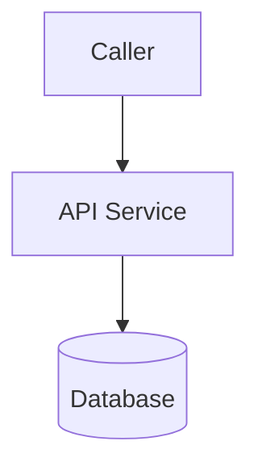

| Property | Value |
| :--- | :--- |
| Endpoints | 11 |
| Base path | `https://nl-govcon-agency-api-qa-internal.nlproducts.net` |

## Architecture

## Endpoints

### POST `/api/contract/v1/vendors`

Get top vendors by program acronym

### POST `/api/contract/v1/vehicles`

Search IDV Groups

### POST `/api/contract/v1/contracts`

Search contract vehicles

### POST `/api/contract/v1/contract-awardees`

Get contract awardees by program acronym

### GET `/api/contract/v1/vendor/{uei}/contracts`

Get vendor contracts

### GET `/api/contract/v1/vehicle`

Get IDV Group detail by group key

### GET `/api/contract/v1/vehicle/classification`

Get contract vehicle classification

### GET `/api/contract/v1/top/vehicle/agencies`

Get top agency contract vehicle

### GET `/api/contract/v1/top/contract-vehicle`

Get top contract vehicle

### GET `/api/contract/v1/contract`

Get contract vehicle detail by PIID

### GET `/api/contract/v1/agency-summary`

Get contract summary by funding agency top-tier org key
