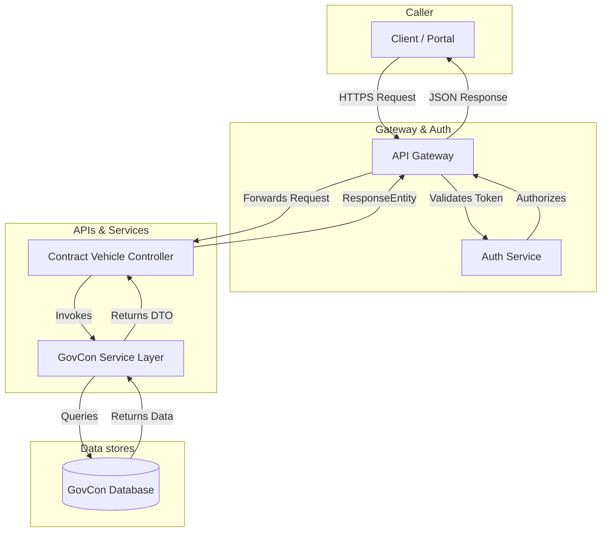

| Property | Value |
| :--- | :--- |
| Deployed as | GovCon API |
| Endpoints | 11 |
| Base path | `https://nl-govcon-agency-api-qa-internal.nlproducts.net` |

## Architecture



## Configuration

- Headers: `Authorization: Bearer <token>`, `Content-Type: application/json`
- Secrets: Managed securely via environment-specific vault storage for database connections and API keys.

## Data

- Schemas: `DataList`, `IDVGroupInput`, `ContractVehicleInput`, `Wrapper`

## Endpoints

### POST `/api/contract/v1/vendors`

Get top vendors by program acronym

Fetch top vendors for a given contract vehicle program based on total award amount.

#### Parameters

| Name | Location | Type | Required | Description |
| :--- | :--- | :--- | :--- | :--- |
| `program_acronym` | query | string | Yes | Program acronym to search vendors for |
| `page` | query | integer(int32) | Yes | Page number |
| `limit` | query | integer(int32) | Yes | Number of records per page |

#### Example Request

```json
{
  "program_acronym": "OASIS",
  "page": 1,
  "limit": 10
}
```

#### Example Response

```json
{
  "total": 1,
  "page": 1,
  "limit": 10,
  "data": [
    {
      "vendor_name": "Example Corp",
      "uei": "ABC123XYZ",
      "total_award_amount": 5000000.00
    }
  ]
}
```

---

### POST `/api/contract/v1/vehicles`

Search IDV Groups

Search IDV Group data based on ceiling range criteria.

#### Parameters

| Name | Location | Type | Required | Description |
| :--- | :--- | :--- | :--- | :--- |
| `page` | query | integer(int32) | Yes | Page number |
| `limit` | query | integer(int32) | Yes | Number of records per page |

#### Example Request

```json
{
  "min_ceiling": 1000000,
  "max_ceiling": 50000000
}
```

#### Example Response

```json
{
  "total": 1,
  "page": 1,
  "limit": 10,
  "data": [
    {
      "idv_group": "IDV-GRP-01",
      "ceiling": 25000000.00
    }
  ]
}
```

---

### POST `/api/contract/v1/contracts`

Search contract vehicles

Search contract vehicle records based on input filters like parent vendor name etc.

#### Parameters

| Name | Location | Type | Required | Description |
| :--- | :--- | :--- | :--- | :--- |
| `page` | query | integer(int32) | Yes | Page number |
| `limit` | query | integer(int32) | Yes | Number of records per page |

#### Example Request

```json
{
  "parent_vendor_name": "Global Technologies"
}
```

#### Example Response

```json
{
  "total": 1,
  "page": 1,
  "limit": 10,
  "data": [
    {
      "contract_number": "GS00Q14OAD3999",
      "title": "OASIS Unrestricted"
    }
  ]
}
```

---

### POST `/api/contract/v1/contract-awardees`

Get contract awardees by program acronym

Get the list of contract awardees under a given contract vehicle program.

#### Parameters

| Name | Location | Type | Required | Description |
| :--- | :--- | :--- | :--- | :--- |
| `program_acronym` | query | string | Yes | Program acronym to fetch awardees for |
| `page` | query | integer(int32) | Yes | Page number |
| `limit` | query | integer(int32) | Yes | Number of records per page |

#### Example Request

```json
{
  "program_acronym": "Alliant 2",
  "page": 1,
  "limit": 10
}
```

#### Example Response

```json
{
  "total": 1,
  "page": 1,
  "limit": 10,
  "data": [
    {
      "awardee_name": "Federal Solutions LLC",
      "uei": "DEF456UVW"
    }
  ]
}
```

---

### GET `/api/contract/v1/vendor/{uei}/contracts`

Get vendor contracts

Get distinct contract number, key and title for a vendor by UEI.

#### Parameters

| Name | Location | Type | Required | Description |
| :--- | :--- | :--- | :--- | :--- |
| `uei` | path | string | Yes | Vendor UEI |

#### Example Request

```http
GET /api/contract/v1/vendor/ABC123XYZ/contracts HTTP/1.1
Host: nl-govcon-agency-api-qa-internal.nlproducts.net
Authorization: Bearer <token>
```

#### Example Response

```json
{
  "status": "success",
  "data": {
    "uei": "ABC123XYZ",
    "contracts": [
      {
        "contract_number": "GS00Q14OAD3999",
        "key": "KEY-01",
        "title": "OASIS Pool 1"
      }
    ]
  }
}
```

---

### GET `/api/contract/v1/vehicle`

Get IDV Group detail by group key

Fetch IDV Group details for a given group key.

#### Parameters

| Name | Location | Type | Required | Description |
| :--- | :--- | :--- | :--- | :--- |
| `idv_group` | query | string | Yes | Group key identifier |

#### Example Request

```http
GET /api/contract/v1/vehicle?idv_group=IDV-GRP-01 HTTP/1.1
Host: nl-govcon-agency-api-qa-internal.nlproducts.net
Authorization: Bearer <token>
```

#### Example Response

```json
{
  "total": 1,
  "page": 1,
  "limit": 10,
  "data": [
    {
      "idv_group": "IDV-GRP-01",
      "description": "Sample IDV Group Details"
    }
  ]
}
```

---

### GET `/api/contract/v1/vehicle/classification`

Get contract vehicle classification

#### Parameters

| Name | Location | Type | Required | Description |
| :--- | :--- | :--- | :--- | :--- |
| `idv_group` | query | string | Yes | contract key |

#### Example Request

```http
GET /api/contract/v1/vehicle/classification?idv_group=KEY-01 HTTP/1.1
Host: nl-govcon-agency-api-qa-internal.nlproducts.net
Authorization: Bearer <token>
```

#### Example Response

```json
{
  "status": "success",
  "data": {
    "classification": "IT Services"
  }
}
```

---

### GET `/api/contract/v1/top/vehicle/agencies`

Get top agency contract vehicle

#### Parameters

| Name | Location | Type | Required | Description |
| :--- | :--- | :--- | :--- | :--- |
| `idv_group` | query | string | Yes | contract key |

#### Example Request

```http
GET /api/contract/v1/top/vehicle/agencies?idv_group=KEY-01 HTTP/1.1
Host: nl-govcon-agency-api-qa-internal.nlproducts.net
Authorization: Bearer <token>
```

#### Example Response

```json
{
  "total": 1,
  "page": 1,
  "limit": 10,
  "data": [
    {
      "agency_name": "Department of Defense",
      "total_obligations": 1200000.00
    }
  ]
}
```

---

### GET `/api/contract/v1/top/contract-vehicle`

Get top contract vehicle

#### Parameters

| Name | Location | Type | Required | Description |
| :--- | :--- | :--- | :--- | :--- |
| `uei` | query | string | Yes | recipient uei |

#### Example Request

```http
GET /api/contract/v1/top/contract-vehicle?uei=ABC123XYZ HTTP/1.1
Host: nl-govcon-agency-api-qa-internal.nlproducts.net
Authorization: Bearer <token>
```

#### Example Response

```json
{
  "status": "success",
  "data": {
    "top_contract_vehicle": "OASIS"
  }
}
```

---

### GET `/api/contract/v1/contract`

Get contract vehicle detail by PIID

Fetch contract vehicle details using the Procurement Instrument Identifier (PIID).

#### Parameters

| Name | Location | Type | Required | Description |
| :--- | :--- | :--- | :--- | :--- |
| `piid` | query | string | Yes | Procurement Instrument Identifier (PIID) |

#### Example Request

```http
GET /api/contract/v1/contract?piid=GS00Q14OAD3999 HTTP/1.1
Host: nl-govcon-agency-api-qa-internal.nlproducts.net
Authorization: Bearer <token>
```

#### Example Response

```json
{
  "total": 1,
  "page": 1,
  "limit": 10,
  "data": [
    {
      "piid": "GS00Q14OAD3999",
      "status": "Active"
    }
  ]
}
```

---

### GET `/api/contract/v1/agency-summary`

Get contract summary by funding agency top-tier org key

Group contract vehicle data by contract key and title, showing total obligations and record count.

#### Parameters

| Name | Location | Type | Required | Description |
| :--- | :--- | :--- | :--- | :--- |
| `funding_org_key` | query | integer(int32) | Yes | Funding agency top-tier org key |
| `page` | query | integer(int32) | Yes | Page number |
| `limit` | query | integer(int32) | Yes | Number of records per page |

#### Example Request

```http
GET /api/contract/v1/agency-summary?funding_org_key=100&page=1&limit=10 HTTP/1.1
Host: nl-govcon-agency-api-qa-internal.nlproducts.net
Authorization: Bearer <token>
```

#### Example Response

```json
{
  "total": 1,
  "page": 1,
  "limit": 10,
  "data": [
    {
      "contract_key": "KEY-01",
      "title": "Sample Contract",
      "total_obligations": 450000.00,
      "record_count": 5
    }
  ]
}
```
