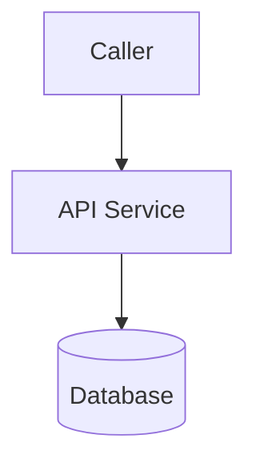

| Property | Value |
| :--- | :--- |
| Endpoints | 15 |
| Base path | `https://nl-govcon-agency-api-qa-internal.nlproducts.net` |

## Architecture

## Endpoints

### GET `/api/master/v1/type`

Retrieve Award Type master list

### GET `/api/master/v1/solicitation-number`

Retrieve Solicitation Number master list

### GET `/api/master/v1/set-aside`

Retrieve Set-Aside master list

### GET `/api/master/v1/self-certification`

Retrieve self certification master list

### GET `/api/master/v1/recipient`

Retrieve Recipient master list

### GET `/api/master/v1/psc`

Retrieve PSC master list

### GET `/api/master/v1/offices`

Retrieve Awarding Office master list

### GET `/api/master/v1/naics`

Retrieve NAICS master list

### GET `/api/master/v1/industry`

Retrieve self industry master list

### GET `/api/master/v1/contract-vehicle`

Retrieve Contract Vehicle master list

### GET `/api/master/v1/contract-number`

Retrieve Contract Number master list

### GET `/api/master/v1/contract-key`

Retrieve Contract key master list

### GET `/api/master/v1/certification`

Retrieve certification master list

### GET `/api/master/v1/cage-code`

Retrieve cage code master list

### GET `/api/master/v1/business-type`

Retrieve Business Type master list
