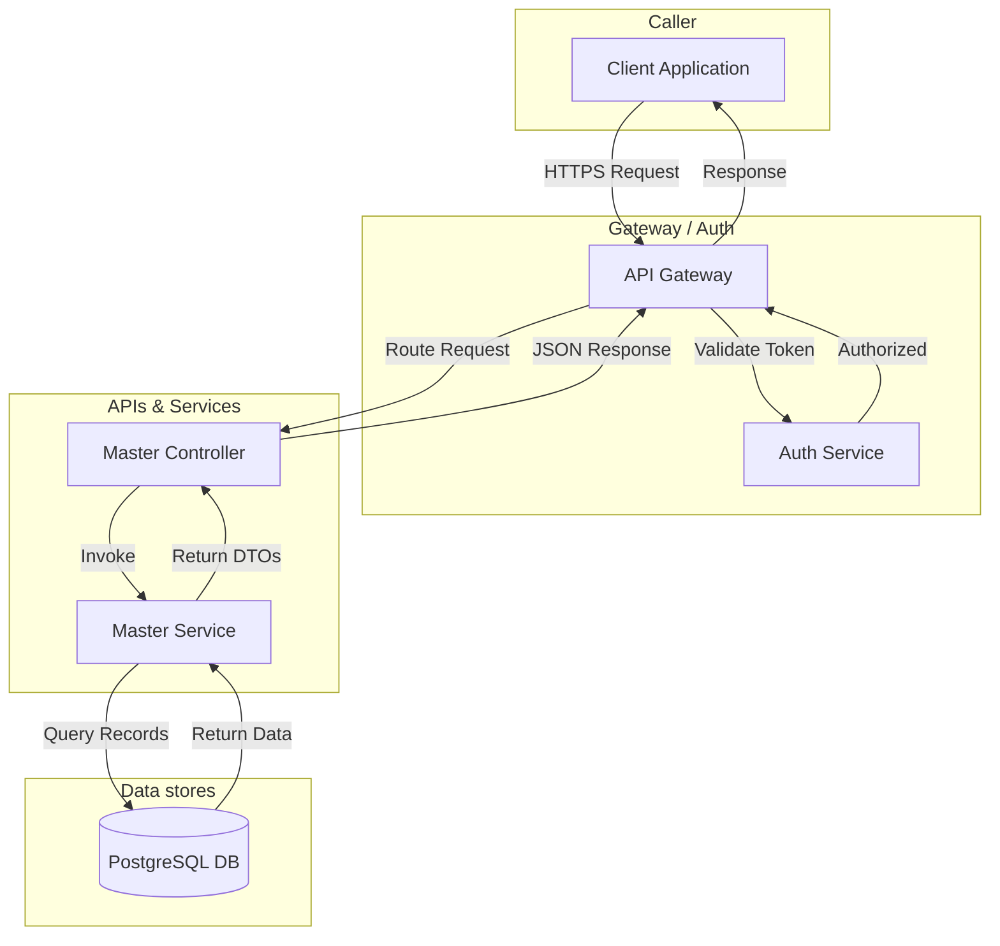

| Property | Value |
| :--- | :--- |
| Deployed as | GovCon API |
| Endpoints | 15 |
| Base path | `https://nl-govcon-agency-api-qa-internal.nlproducts.net` |

:::note
This page covers Part 1 of the Master APIs. Additional items continue in Part 2.
:::

## Architecture



## Configuration

- Headers: `Authorization: Bearer <token>` required for all endpoints.
- Secrets: Managed securely via environment variables and secret stores for downstream database connectivity.

## Data

- Schemas: Responses are wrapped in a standard `Wrapper` object containing metadata and the requested master data items.

## Endpoints

### GET /api/master/v1/type

Retrieve Award Type master list

Retrieves the list of award types. Supports optional keyword-based searching using the specified search option (EXACT, STARTS_WITH, ENDS_WITH, or CONTAINS). If no keyword is provided, all award types are returned.

#### Parameters

| Name | Location | Type | Required | Description |
| :--- | :--- | :--- | :--- | :--- |
| `keyword` | query | string | No | Optional search keyword |
| `search_option` | query | string | No | Search option (`EXACT`, `STARTS_WITH`, `ENDS_WITH`, `CONTAINS`) |

#### Responses

**200 OK**

```json
{
  "success": true,
  "status": 200,
  "message": "Success",
  "data": [
    {
      "id": 1,
      "code": "A",
      "description": "Award"
    }
  ]
}
```

**500 Internal Error**

```json
{
  "success": false,
  "status": 500,
  "message": "Internal server error"
}
```

---

### GET /api/master/v1/solicitation-number

Retrieve Solicitation Number master list

Retrieves the list of solicitation numbers. Supports optional keyword-based searching using the specified search option (EXACT, STARTS_WITH, ENDS_WITH, or CONTAINS). If no keyword is provided, all solicitation numbers are returned.

#### Parameters

| Name | Location | Type | Required | Description |
| :--- | :--- | :--- | :--- | :--- |
| `keyword` | query | string | No | Optional search keyword |
| `search_option` | query | string | No | Search option |

#### Responses

**200 OK**

```json
{
  "success": true,
  "status": 200,
  "message": "Success",
  "data": []
}
```

**500 Internal Error**

```json
{
  "success": false,
  "status": 500,
  "message": "Internal server error"
}
```

---

### GET /api/master/v1/set-aside

Retrieve Set-Aside master list

Retrieves the list of set-asides. Supports optional keyword-based searching using the specified search option (EXACT, STARTS_WITH, ENDS_WITH, or CONTAINS). If no keyword is provided, all set-asides are returned.

#### Parameters

| Name | Location | Type | Required | Description |
| :--- | :--- | :--- | :--- | :--- |
| `keyword` | query | string | No | Optional search keyword |
| `search_option` | query | string | No | Search option |

#### Responses

**200 OK**

```json
{
  "success": true,
  "status": 200,
  "message": "Success",
  "data": []
}
```

**500 Internal Error**

```json
{
  "success": false,
  "status": 500,
  "message": "Internal server error"
}
```

---

### GET /api/master/v1/self-certification

Retrieve self certification master list

Retrieves the list of self certification. Supports optional keyword-based searching using the specified search option (EXACT, STARTS_WITH, ENDS_WITH, or CONTAINS). If no keyword is provided, all contract key are returned.

#### Parameters

| Name | Location | Type | Required | Description |
| :--- | :--- | :--- | :--- | :--- |
| `keyword` | query | string | No | Optional search keyword |
| `search_option` | query | string | No | Search option |

#### Responses

**200 OK**

```json
{
  "success": true,
  "status": 200,
  "message": "Success",
  "data": []
}
```

**500 Internal Error**

```json
{
  "success": false,
  "status": 500,
  "message": "Internal server error"
}
```

---

### GET /api/master/v1/recipient

Retrieve Recipient master list

Retrieves the list of recipients. With search_option CONTAINS, STARTS_WITH, PREFIX, FUZZY, PHRASE or ALL the keyword is a typeahead search: the last word matches as a prefix, words may contain typos, a full UEI matches exactly, and results are ranked best first with larger award totals ahead. EXACT, ENDS_WITH and the other options keep their literal SQL meaning. page (0-based) and limit page the results; without a limit up to 1000 rows are returned. If no keyword is provided, the recipients with the largest award totals come first.

#### Parameters

| Name | Location | Type | Required | Description |
| :--- | :--- | :--- | :--- | :--- |
| `keyword` | query | string | No | Optional search keyword |
| `search_option` | query | string | No | Search option |
| `page` | query | integer(int32) | No | Page number (0-based) |
| `limit` | query | integer(int32) | No | Number of records to return |

#### Responses

**200 OK**

```json
{
  "success": true,
  "status": 200,
  "message": "Success",
  "data": []
}
```

**500 Internal Error**

```json
{
  "success": false,
  "status": 500,
  "message": "Internal server error"
}
```

---

### GET /api/master/v1/psc

Retrieve PSC master list

Retrieves the list of PSC (Product Service Code) identifiers and descriptions. With search_option CONTAINS, STARTS_WITH, PREFIX, FUZZY, PHRASE or ALL the keyword is a typeahead search: a partly typed code containing a digit (da0, r4) lists the codes that start with it; words match the short and full PSC names in any order, the last word as a prefix and with typos allowed. EXACT, ENDS_WITH and the other options keep their literal SQL meaning. page (0-based) and limit page the results; without a limit up to 1000 rows are returned.

#### Parameters

| Name | Location | Type | Required | Description |
| :--- | :--- | :--- | :--- | :--- |
| `keyword` | query | string | No | Optional search keyword |
| `search_option` | query | string | No | Search option |
| `page` | query | integer(int32) | No | Page number (0-based) |
| `limit` | query | integer(int32) | No | Number of records to return |

#### Responses

**200 OK**

```json
{
  "success": true,
  "status": 200,
  "message": "Success",
  "data": []
}
```

**500 Internal Error**

```json
{
  "success": false,
  "status": 500,
  "message": "Internal server error"
}
```

---

### GET /api/master/v1/offices

Retrieve Awarding Office master list

Retrieves the list of awarding offices. Supports optional keyword-based searching using the specified search option (EXACT, STARTS_WITH, ENDS_WITH, or CONTAINS). If no keyword is provided, all awarding offices are returned.

#### Parameters

| Name | Location | Type | Required | Description |
| :--- | :--- | :--- | :--- | :--- |
| `keyword` | query | string | No | Optional search keyword |
| `search_option` | query | string | No | Search option |

#### Responses

**200 OK**

```json
{
  "success": true,
  "status": 200,
  "message": "Success",
  "data": []
}
```

**500 Internal Error**

```json
{
  "success": false,
  "status": 500,
  "message": "Internal server error"
}
```

---

### GET /api/master/v1/naics

Retrieve NAICS master list

Retrieves the list of NAICS (North American Industry Classification System) codes and descriptions. With search_option CONTAINS, STARTS_WITH, PREFIX, FUZZY, PHRASE or ALL the keyword is a typeahead search: a partly typed code (5415) lists the codes that start with it, shortest first; words match the description in any order, the last word as a prefix and with typos allowed, six-digit industries ranked first. EXACT, ENDS_WITH and the other options keep their literal SQL meaning. page (0-based) and limit page the results; without a limit up to 1000 rows are returned.

#### Parameters

| Name | Location | Type | Required | Description |
| :--- | :--- | :--- | :--- | :--- |
| `keyword` | query | string | No | Optional search keyword |
| `search_option` | query | string | No | Search option |
| `page` | query | integer(int32) | No | Page number (0-based) |
| `limit` | query | integer(int32) | No | Number of records to return |

#### Responses

**200 OK**

```json
{
  "success": true,
  "status": 200,
  "message": "Success",
  "data": []
}
```

**500 Internal Error**

```json
{
  "success": false,
  "status": 500,
  "message": "Internal server error"
}
```

---

### GET /api/master/v1/industry

Retrieve self industry master list

Retrieves the list of industry. Supports optional keyword-based searching using the specified search option (EXACT, STARTS_WITH, ENDS_WITH, or CONTAINS). If no keyword is provided, all contract key are returned.

#### Parameters

| Name | Location | Type | Required | Description |
| :--- | :--- | :--- | :--- | :--- |
| `keyword` | query | string | No | Optional search keyword |
| `search_option` | query | string | No | Search option |

#### Responses

**200 OK**

```json
{
  "success": true,
  "status": 200,
  "message": "Success",
  "data": []
}
```

**500 Internal Error**

```json
{
  "success": false,
  "status": 500,
  "message": "Internal server error"
}
```

---

### GET /api/master/v1/contract-vehicle

Retrieve Contract Vehicle master list

Retrieves the list of contract vehicles. Supports optional keyword-based searching using the specified search option (EXACT, STARTS_WITH, ENDS_WITH, or CONTAINS). If no keyword is provided, all contract vehicles are returned.

#### Parameters

| Name | Location | Type | Required | Description |
| :--- | :--- | :--- | :--- | :--- |
| `keyword` | query | string | No | Optional search keyword |
| `search_option` | query | string | No | Search option |

#### Responses

**200 OK**

```json
{
  "success": true,
  "status": 200,
  "message": "Success",
  "data": []
}
```

**500 Internal Error**

```json
{
  "success": false,
  "status": 500,
  "message": "Internal server error"
}
```

---

### GET /api/master/v1/contract-number

Retrieve Contract Number master list

Retrieves the list of contract numbers. Supports optional keyword-based searching using the specified search option (EXACT, STARTS_WITH, ENDS_WITH, or CONTAINS). If no keyword is provided, all contract numbers are returned.

#### Parameters

| Name | Location | Type | Required | Description |
| :--- | :--- | :--- | :--- | :--- |
| `keyword` | query | string | No | Optional search keyword |
| `search_option` | query | string | No | Search option |

#### Responses

**200 OK**

```json
{
  "success": true,
  "status": 200,
  "message": "Success",
  "data": []
}
```

**500 Internal Error**

```json
{
  "success": false,
  "status": 500,
  "message": "Internal server error"
}
```

---

### GET /api/master/v1/contract-key

Retrieve Contract key master list

Retrieves the list of contract key. Supports optional keyword-based searching using the specified search option (EXACT, STARTS_WITH, ENDS_WITH, or CONTAINS). If no keyword is provided, all contract key are returned.

#### Parameters

| Name | Location | Type | Required | Description |
| :--- | :--- | :--- | :--- | :--- |
| `keyword` | query | string | No | Optional search keyword |
| `search_option` | query | string | No | Search option |

#### Responses

**200 OK**

```json
{
  "success": true,
  "status": 200,
  "message": "Success",
  "data": []
}
```

**500 Internal Error**

```json
{
  "success": false,
  "status": 500,
  "message": "Internal server error"
}
```

---

### GET /api/master/v1/certification

Retrieve certification master list

Retrieves the list of certification. Supports optional keyword-based searching using the specified search option (EXACT, STARTS_WITH, ENDS_WITH, or CONTAINS). If no keyword is provided, all contract key are returned.

#### Parameters

| Name | Location | Type | Required | Description |
| :--- | :--- | :--- | :--- | :--- |
| `keyword` | query | string | No | Optional search keyword |
| `search_option` | query | string | No | Search option |

#### Responses

**200 OK**

```json
{
  "success": true,
  "status": 200,
  "message": "Success",
  "data": []
}
```

**500 Internal Error**

```json
{
  "success": false,
  "status": 500,
  "message": "Internal server error"
}
```

---

### GET /api/master/v1/cage-code

Retrieve cage code master list

Retrieves the list of cage code. Supports optional keyword-based searching using the specified search option (EXACT, STARTS_WITH, ENDS_WITH, or CONTAINS). If no keyword is provided, all ccage code are returned.

#### Parameters

| Name | Location | Type | Required | Description |
| :--- | :--- | :--- | :--- | :--- |
| `keyword` | query | string | No | Optional search keyword |
| `search_option` | query | string | No | Search option |

#### Responses

**200 OK**

```json
{
  "success": true,
  "status": 200,
  "message": "Success",
  "data": []
}
```

**500 Internal Error**

```json
{
  "success": false,
  "status": 500,
  "message": "Internal server error"
}
```

---

### GET /api/master/v1/business-type

Retrieve Business Type master list

Retrieves the list of business types. Supports optional keyword-based searching using the specified search option (EXACT, STARTS_WITH, ENDS_WITH, or CONTAINS). If no keyword is provided, all business types are returned.

#### Parameters

| Name | Location | Type | Required | Description |
| :--- | :--- | :--- | :--- | :--- |
| `keyword` | query | string | No | Optional search keyword |
| `search_option` | query | string | No | Search option |

#### Responses

**200 OK**

```json
{
  "success": true,
  "status": 200,
  "message": "Success",
  "data": []
}
```

**500 Internal Error**

```json
{
  "success": false,
  "status": 500,
  "message": "Internal server error"
}
```
