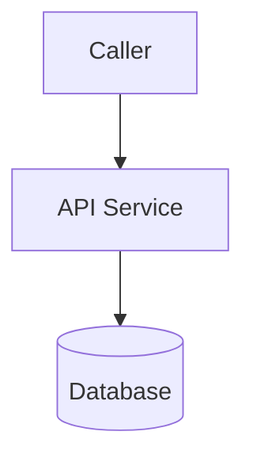

| Property | Value |
| :--- | :--- |
| Endpoints | 10 |
| Base path | `https://nl-govcon-agency-api-qa-internal.nlproducts.net` |

## Architecture

## Endpoints

### POST `/api/misc/v1/sic`

Get SIC records

### POST `/api/misc/v1/psc`

Get all PSC entries with full metadata

### POST `/api/misc/v1/naics/categories`

Get all unique NAICS codes and descriptions

### POST `/api/misc/v1/business-types`

Get distinct business types

### GET `/api/misc/v1/psc/hierarchy`

Get psc hierarchy

### GET `/api/misc/v1/psc/categories/detailed`

Get unique PSC categories with IDs and full names

### GET `/api/misc/v1/place-of-performance/resolve`

Split a place of performance into structured address parts

### GET `/api/misc/v1/naics/hierarchy`

Get NAICS hierarchy and immediate children

### GET `/api/misc/v1/naics/all/hierarchy`

Retrieve NAICS hierarchy

### GET `/api/misc/v1/agency/resolve`

Resolve an agency name to its org_key
