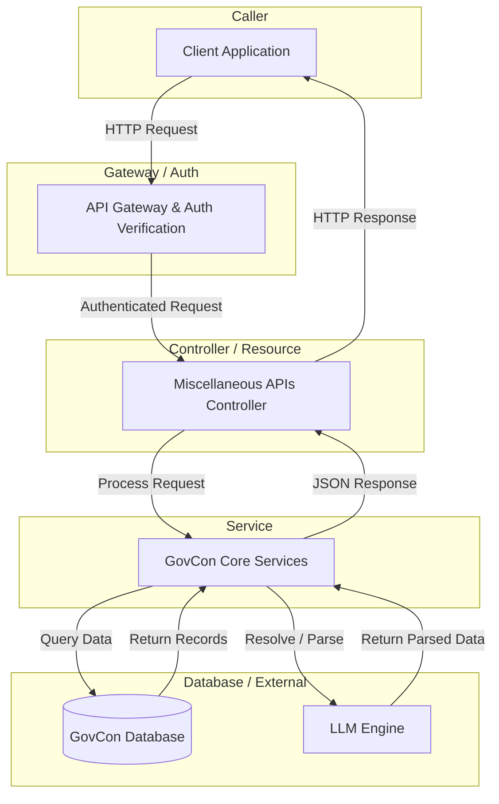

description: "Access miscellaneous GovCon reference data including SIC, PSC, NAICS codes, business types, and entity resolution."

| Property | Value |
| :--- | :--- |
| Deployed as | GovCon API |
| Endpoints | 10 |
| Base path | `https://nl-govcon-agency-api-qa-internal.nlproducts.net` |

## Architecture



## Data

- Authentication: Required (`auth_required: true` for all endpoints)
- Request Schemas: `SicInput`, `PscInput`, `NaicsInput`
- Response Schemas: `DataList`, `Wrapper`

## Endpoints

### POST /api/misc/v1/sic

Fetches a paginated list of SIC records (Standard Industrial Classification).

#### Parameters

| Name | Location | Type | Required | Description |
| :--- | :--- | :--- | :--- | :--- |
| `page` | query | integer(int32) | Yes | Page number |
| `limit` | query | integer(int32) | Yes | Items per page |

#### Request Body Schema

`SicInput`

```json
{
  "search_term": "manufacturing"
}
```

#### Response Example

```json
{
  "status": "success",
  "data": [
    {
      "code": "3571",
      "description": "Electronic Computers"
    }
  ],
  "pagination": {
    "page": 1,
    "limit": 10,
    "total": 1
  }
}
```

---

### POST /api/misc/v1/psc

Get all PSC entries with full metadata.

#### Parameters

| Name | Location | Type | Required | Description |
| :--- | :--- | :--- | :--- | :--- |
| `page` | query | integer(int32) | No | Page number |
| `limit` | query | integer(int32) | No | Items per page |

#### Request Body Schema

`PscInput`

```json
{
  "category": "D"
}
```

#### Response Example

```json
{
  "status": "success",
  "data": [
    {
      "psc_code": "D302",
      "psc_full_name": "IT and Telecom - Systems Development"
    }
  ]
}
```

---

### POST /api/misc/v1/naics/categories

Get all unique NAICS codes and descriptions.

#### Parameters

| Name | Location | Type | Required | Description |
| :--- | :--- | :--- | :--- | :--- |
| `is_autocomplete` | query | boolean | No | Filter for autocomplete |
| `page` | query | integer(int32) | Yes | Page number |
| `limit` | query | integer(int32) | Yes | Items per page |

#### Request Body Schema

`NaicsInput`

```json
{
  "query": "5415"
}
```

#### Response Example

```json
{
  "status": "success",
  "data": [
    {
      "naics_code": "541512",
      "description": "Computer Systems Design Services"
    }
  ]
}
```

---

### POST /api/misc/v1/business-types

Fetches a list of all unique business types of vendors.

#### Parameters

| Name | Location | Type | Required | Description |
| :--- | :--- | :--- | :--- | :--- |
| `page` | query | integer(int32) | Yes | Page number |
| `limit` | query | integer(int32) | Yes | Items per page |

#### Response Example

```json
{
  "status": "success",
  "data": [
    {
      "business_type_code": "80",
      "business_type_name": "Small Business"
    }
  ]
}
```

---

### GET /api/misc/v1/psc/hierarchy

Fetches a psc hierarchy.

#### Response Example

```json
{
  "status": "success",
  "data": {
    "code": "D",
    "name": "IT and Telecom",
    "children": []
  }
}
```

---

### GET /api/misc/v1/psc/categories/detailed

Returns unique Level 1 and Level 2 PSC category combinations along with PSC entries containing both id and psc_full_name.

#### Parameters

| Name | Location | Type | Required | Description |
| :--- | :--- | :--- | :--- | :--- |
| `page` | query | integer(int32) | Yes | Page number |
| `limit` | query | integer(int32) | Yes | Items per page |

#### Response Example

```json
{
  "status": "success",
  "data": [
    {
      "id": "D3",
      "psc_full_name": "IT and Telecom"
    }
  ]
}
```

---

### GET /api/misc/v1/place-of-performance/resolve

Breaks a free-text place of performance into street address, city, state, zip and country.

#### Parameters

| Name | Location | Type | Required | Description |
| :--- | :--- | :--- | :--- | :--- |
| `address` | query | string | Yes | Place of performance as written |

#### Response Example

```json
{
  "status": {
    "message": "SUCCESS"
  },
  "data": [
    {
      "street": "",
      "city": "Arlington",
      "state": "Virginia",
      "state_code": "VA",
      "zip": "22202",
      "country": "USA"
    }
  ]
}
```

---

### GET /api/misc/v1/naics/hierarchy

Returns the full hierarchy (ancestors) for a given NAICS code, along with the immediate children.

#### Parameters

| Name | Location | Type | Required | Description |
| :--- | :--- | :--- | :--- | :--- |
| `naicsCode` | query | string | Yes | NAICS code for which to fetch hierarchy |
| `page` | query | integer(int32) | No | Page number |
| `limit` | query | integer(int32) | No | Items per page |

#### Response Example

```json
{
  "status": "success",
  "data": {
    "naicsCode": "541512",
    "ancestors": [],
    "children": []
  }
}
```

---

### GET /api/misc/v1/naics/all/hierarchy

Retrieves the complete NAICS (North American Industry Classification System) hierarchy as a tree structure.

#### Response Example

```json
{
  "status": "success",
  "data": {
    "tree": []
  }
}
```

---

### GET /api/misc/v1/agency/resolve

Resolves a plain-English agency name, short name or code to a single canonical agency.

#### Parameters

| Name | Location | Type | Required | Description |
| :--- | :--- | :--- | :--- | :--- |
| `name` | query | string | Yes | Agency name, short name or code |
| `parent` | query | string | No | Optional parent agency hint (name or org_key) used to break ties |
| `include_offices` | query | boolean | No | Widen the search from departments/sub-agencies to contracting offices |

#### Response Example

```json
{
  "status": {
    "message": "SUCCESS"
  },
  "data": [
    {
      "org_key": "12345",
      "agency_name": "Department of Defense"
    }
  ]
}
```
