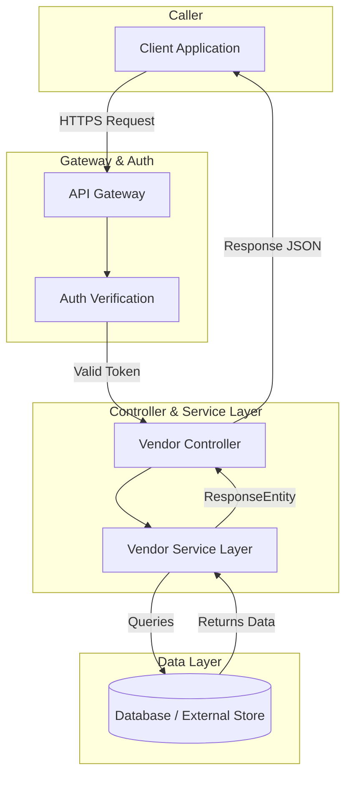

| Property | Value |
| :--- | :--- |
| Deployed as | GovCon Agency API QA Internal |
| Endpoints | 12 |
| Base path | `https://nl-govcon-agency-api-qa-internal.nlproducts.net` |

## Architecture



## Configuration

- Headers: Requires standard authorization headers (`Authorization: Bearer <token>`) for all endpoints.
- Secrets: Managed securely via environment-specific configuration vaults.

## Data

- Schemas: `VendorInput`, `DataList`, `Wrapper`, `SbaEntities`, `PeopleSearchCriteria`.

## Endpoints

### POST /api/vendor/v1/vendors

Search vendor details based on filters such as city, state, country, or business keywords.

**Parameters**

| Name | Location | Type | Required | Description |
| :--- | :--- | :--- | :--- | :--- |
| `page` | query | integer(int32) | Yes | Page number |
| `limit` | query | integer(int32) | Yes | Items per page |

**Request Body** (`VendorInput`)

```json
{
  "keywords": "defense engineering",
  "state": "VA",
  "country": "USA"
}
```

**Response Example** (`DataList`)

```json
{
  "page": 1,
  "limit": 10,
  "total": 1,
  "items": [
    {
      "uei": "ABC123XYZ456",
      "vendor_name": "Acme GovCon Solutions",
      "city": "Arlington",
      "state": "VA"
    }
  ]
}
```

---

### POST /api/vendor/v1/states

Fetch a list of unique states where vendors are located.

**Parameters**

| Name | Location | Type | Required | Description |
| :--- | :--- | :--- | :--- | :--- |
| `page` | query | integer(int32) | Yes | Page number |
| `limit` | query | integer(int32) | Yes | Items per page |

**Response Example** (`DataList`)

```json
{
  "page": 1,
  "limit": 10,
  "total": 2,
  "items": [
    { "state": "VA" },
    { "state": "MD" }
  ]
}
```

---

### GET /api/vendor/v1/sba-entities

Retrieves SBA entity details based on the optional `entity_detail_id` and `uei` parameters.

**Parameters**

| Name | Location | Type | Required | Description |
| :--- | :--- | :--- | :--- | :--- |
| `entity_detail_id` | query | string | No | SBA entity detail identifier |
| `uei` | query | string | No | Unique Entity Identifier |

**Response Example** (`Wrapper`)

```json
{
  "status": "success",
  "data": {
    "entity_detail_id": "SBA-9876",
    "uei": "ABC123XYZ456",
    "program_type": "8(a)"
  }
}
```

---

### POST /api/vendor/v1/sba-entities

Ignores other filters and returns vendors ordered exactly as the UEIs are provided in the request body.

**Parameters**

| Name | Location | Type | Required | Description |
| :--- | :--- | :--- | :--- | :--- |
| `page` | query | integer(int32) | Yes | Page number (0-based) |
| `limit` | query | integer(int32) | Yes | Items per page |

**Request Body** (`SbaEntities`)

```json
{
  "ueis": [
    "ABC123XYZ456",
    "DEF789UVW012"
  ]
}
```

**Response Example** (`DataList`)

```json
{
  "page": 0,
  "limit": 10,
  "total": 2,
  "items": [
    { "uei": "ABC123XYZ456", "sba_certified": true }
  ]
}
```

---

### POST /api/vendor/v1/people

Get vendors people contact data.

**Parameters**

| Name | Location | Type | Required | Description |
| :--- | :--- | :--- | :--- | :--- |
| `page` | query | integer(int32) | Yes | Page number (0-based) |
| `limit` | query | integer(int32) | Yes | Items per page |

**Request Body** (`PeopleSearchCriteria`)

```json
{
  "uei": "ABC123XYZ456",
  "title": "Contract Officer"
}
```

**Response Example** (`DataList`)

```json
{
  "page": 0,
  "limit": 10,
  "total": 1,
  "items": [
    {
      "name": "Jane Doe",
      "email": "jane.doe@example.com",
      "title": "Contract Officer"
    }
  ]
}
```

---

### POST /api/vendor/v1/ordered-vendors

Ignores other filters and returns vendors ordered exactly as the UEIs are provided in the request body.

**Parameters**

| Name | Location | Type | Required | Description |
| :--- | :--- | :--- | :--- | :--- |
| `page` | query | integer(int32) | Yes | Page number (0-based) |
| `limit` | query | integer(int32) | Yes | Items per page |

**Request Body** (`VendorInput`)

```json
{
  "ueis": ["XYZ987", "ABC123XYZ456"]
}
```

**Response Example** (`DataList`)

```json
{
  "page": 0,
  "limit": 10,
  "total": 2,
  "items": [
    { "uei": "XYZ987" },
    { "uei": "ABC123XYZ456" }
  ]
}
```

---

### POST /api/vendor/v1/countries

Fetch a list of unique countries where vendors are located.

**Parameters**

| Name | Location | Type | Required | Description |
| :--- | :--- | :--- | :--- | :--- |
| `page` | query | integer(int32) | Yes | Page number |
| `limit` | query | integer(int32) | Yes | Items per page |

**Response Example** (`DataList`)

```json
{
  "page": 1,
  "limit": 10,
  "total": 1,
  "items": [
    { "country": "USA" }
  ]
}
```

---

### POST /api/vendor/v1/cities

Fetch a list of unique cities where vendors are located.

**Parameters**

| Name | Location | Type | Required | Description |
| :--- | :--- | :--- | :--- | :--- |
| `page` | query | integer(int32) | Yes | Page number |
| `limit` | query | integer(int32) | Yes | Items per page |

**Response Example** (`DataList`)

```json
{
  "page": 1,
  "limit": 10,
  "total": 1,
  "items": [
    { "city": "Arlington" }
  ]
}
```

---

### POST /api/vendor/v1/associates

Returns sibling vendors (same parent_uei as input UEI, excluding the input) or child vendors (whose parent_uei matches the input UEI), depending on the relationship type.

**Parameters**

| Name | Location | Type | Required | Description |
| :--- | :--- | :--- | :--- | :--- |
| `uei` | query | string | Yes | UEI of the vendor |
| `type` | query | string | Yes | Relationship type: 'sibling' or 'child' |
| `page` | query | integer(int32) | Yes | Page number |
| `limit` | query | integer(int32) | Yes | Items per page |

**Response Example** (`DataList`)

```json
{
  "page": 1,
  "limit": 10,
  "total": 1,
  "items": [
    {
      "uei": "CHILD001XYZ",
      "vendor_name": "Acme Subsidiary LLC",
      "parent_uei": "ABC123XYZ456"
    }
  ]
}
```

---

### GET /api/vendor/v1/spending-over-time

Get agencies vendor by org key.

**Parameters**

| Name | Location | Type | Required | Description |
| :--- | :--- | :--- | :--- | :--- |
| `uei` | query | string | Yes | Unique Entity Identifier |
| `type` | query | string | Yes | Spending metric type |

**Response Example** (`Wrapper`)

```json
{
  "status": "success",
  "data": [
    { "fiscal_year": 2023, "amount": 1500000.00 }
  ]
}
```

---

### GET /api/vendor/v1/last-fy-obligation

Get vendor last fy obligation.

**Parameters**

| Name | Location | Type | Required | Description |
| :--- | :--- | :--- | :--- | :--- |
| `uei` | query | string | Yes | Unique Entity Identifier |

**Response Example** (`Wrapper`)

```json
{
  "status": "success",
  "data": {
    "fiscal_year": 2023,
    "total_obligation": 500000.00
  }
}
```

---

### GET /api/vendor/v1/detail

Fetch vendor information for the given UEI.

**Parameters**

| Name | Location | Type | Required | Description |
| :--- | :--- | :--- | :--- | :--- |
| `uei` | query | string | Yes | Unique Entity Identifier (UEI) of the vendor |

**Response Example** (`DataList`)

```json
{
  "page": 1,
  "limit": 1,
  "total": 1,
  "items": [
    {
      "uei": "ABC123XYZ456",
      "vendor_name": "Acme GovCon Solutions",
      "address": "123 Federal Way",
      "city": "Arlington",
      "state": "VA",
      "country": "USA"
    }
  ]
}
```
