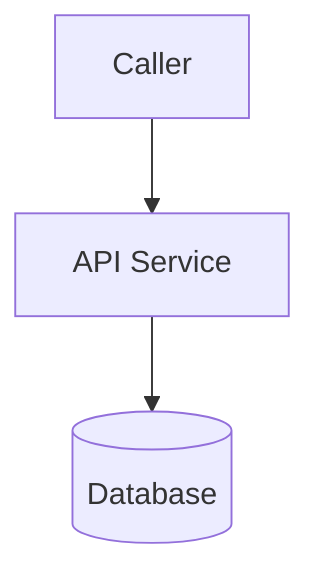

| Property | Value |
| :--- | :--- |
| Endpoints | 12 |
| Base path | `https://nl-govcon-agency-api-qa-internal.nlproducts.net` |

## Architecture

## Endpoints

### POST `/api/vendor/v1/vendors`

Search vendor details

### POST `/api/vendor/v1/states`

Get distinct vendor states

### GET `/api/vendor/v1/sba-entities`

Get sba entities

### POST `/api/vendor/v1/sba-entities`

Get sba entities

### POST `/api/vendor/v1/people`

Get Vendor Contacts

### POST `/api/vendor/v1/ordered-vendors`

Get vendors in the same order as input UEIs

### POST `/api/vendor/v1/countries`

Get distinct vendor countries

### POST `/api/vendor/v1/cities`

Get distinct vendor cities

### POST `/api/vendor/v1/associates`

Get vendors based on relationship type (sibling or child)

### GET `/api/vendor/v1/spending-over-time`

Get agencies vendor by org key

### GET `/api/vendor/v1/last-fy-obligation`

Get vendor last fy obligation

### GET `/api/vendor/v1/detail`

Get vendor detail by UEI
