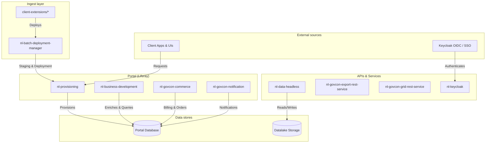

description: "Engineering-grade architecture reference for GovCon360 modules, classes, and integration endpoints."

:::warning[INTERNAL]
This page is for engineering and operations. It documents internal services, extensions, and configurations without exposing credentials.
:::

## System overview

The GovCon360 repository comprises 4,527 total files across modular Java OSGi bundles (`modules/`), Liferay client extensions (`client-extensions/`), and configuration artifacts. Java components are structured into 1,243 classes (614 custom classes, 629 generated annotations/sources), spanning various class types (`CLASS`, `RECORD`, `INTERFACE`, `ENUM`). Core layers incorporate provisioning, business development, Keycloak OIDC authentication, commerce services, analytics, and headless data APIs.

## Components and extensions

**Java Components**

| Component | Type | Friendly URL / Config | OAuth Scopes / Details |
| :--- | :--- | :--- | :--- |
| `GovConBillingConfigurationResource` | `CLASS` | `modules/commerce/govcon-billing-cron` | Component, Path |
| `DefaultCompanyBillingContactsResource` | `CLASS` | `modules/commerce/nl-govcon-commerce` | Component, Path |
| `DefaultCompanyBillingContractsResource` | `CLASS` | `modules/commerce/nl-govcon-commerce` | Component, Path |
| `PlacedOrderByExternalReferenceCodeResource` | `CLASS` | `modules/commerce/nl-govcon-commerce` | Component, Path |
| `EnrichmentDebugResource` | `CLASS` | `modules/govcon360/nl-business-development` | Component, Path |
| `BatchDeploymentPanelApp` | `CLASS` | `modules/common/nl-batch-deployment-manager` | OSGi Panel App |
| `BatchDeploymentPortlet` | `CLASS` | `modules/common/nl-batch-deployment-manager` | OSGi Portlet |
| `ClientExtensionPackageService` | `CLASS` | `modules/common/nl-batch-deployment-manager` | OSGi Service |
| `EmailResourceImpl` | `CLASS` | `modules/common/nl-govcon-notification` | REST Resource (v1.0) |
| `NotificationResourceImpl` | `CLASS` | `modules/common/nl-govcon-notification` | REST Resource (v1.0) |

**OSGi Configurations**

| Component | Type | Friendly URL / Config | OAuth Scopes / Details |
| :--- | :--- | :--- | :--- |
| `GovConBillingConfiguration` | `INTERFACE` | `modules/commerce/govcon-billing-cron` | `Meta.OCD`, `ExtendedObjectClassDefinition` |
| `NlAnalyticsInstanceConfiguration` | `INTERFACE` | `modules/common/nl-analytics` | `Meta.OCD`, `ExtendedObjectClassDefinition` |
| `BatchDeploymentConfiguration` | `INTERFACE` | `modules/common/nl-batch-deployment-manager` | `Meta.OCD`, `ExtendedObjectClassDefinition` |
| `EmailSenderConfiguration` | `INTERFACE` | `modules/common/nl-govcon-notification` | `Meta.OCD`, `ExtendedObjectClassDefinition` |
| `NlKeycloakConfiguration` | `INTERFACE` | `modules/common/nl-keycloak` | `Meta.OCD`, `ExtendedObjectClassDefinition` |
| `LogManagementConfiguration` | `INTERFACE` | `modules/common/nl-log-management` | `Meta.OCD`, `ExtendedObjectClassDefinition` |
| `HomeURLFilterConfiguration` | `INTERFACE` | `modules/common/nl-login` | `Meta.OCD`, `ExtendedObjectClassDefinition` |
| `B2BSsoProvisioningConfiguration` | `INTERFACE` | `modules/common/nl-provisioning` | `Meta.OCD`, `ExtendedObjectClassDefinition` |
| `APIGatewayConfiguration` | `INTERFACE` | `modules/govcon360/nl-govcon-api-helper` | `Meta.OCD`, `ExtendedObjectClassDefinition` |
| `DatalakeConfiguration` | `INTERFACE` | `modules/govcon360/nl-govcon-datalake` | `Meta.OCD`, `ExtendedObjectClassDefinition` |

## Data and integration points

The platform utilizes modular OSGi services and client extensions to manage batch deployments, billing cron jobs, and secure headless data delivery.

- **Batch Deployments**: Managed via `modules/common/nl-batch-deployment-manager` using `BatchDeploymentConfiguration` for staging and deployment directories.
- **Commerce & Billing Automation**: Handled through `modules/commerce/govcon-billing-cron` via `GovConBillingDispatchTaskExecutor` and `InvoiceJob` interacting with Liferay Commerce APIs.
- **Keycloak OIDC Integration**: Centralized in `modules/common/nl-keycloak` supporting B2B provisioning, administrative realms, client secrets, and user password verifications.
- **Notification Services**: Configured via `modules/common/nl-govcon-notification` to handle email delivery receipts, user notifications, and template routing by External Reference Code (`ERC`).
