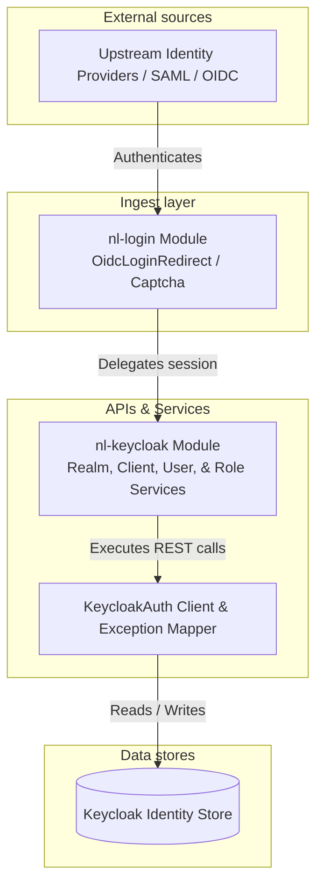

:::warning[INTERNAL]
This page is for engineering and operations. It documents internal services, extensions, and configurations without exposing credentials.
:::

## System overview

The authentication subsystem within GovCon360 manages identity synchronization, OIDC login redirection, Keycloak realm provisioning, and session/role management across modules. The system spans two main code modules: `modules/common/nl-keycloak` (handling core Keycloak REST integrations, identity providers, client management, and role synchronization) and `modules/common/nl-login` (managing portal login filters, redirect policies, and captcha actions).

## Components and extensions

The table below outlines the core configuration interfaces, REST resources, and service components across the authentication modules.

| Component | Type | Friendly URL / Config | OAuth Scopes / Details |
| :--- | :--- | :--- | :--- |
| `NlKeycloakConfiguration` | Interface (`Meta.OCD`) | `nl.govcon.keycloak.configuration` | Server URL, admin realm credentials, and provisioning switches. |
| `NlKeycloakRealmConfiguration` | Interface (`Meta.OCD`) | `nl.govcon.keycloak.configuration` | Realm-specific SMTP settings, host, port, and sender configuration. |
| `RoleSyncConfiguration` | Interface (`Meta.OCD`) | `nl.govcon.keycloak.oidc.internal` | Enables/disables regular and organization role synchronization. |
| `HomeURLFilterConfiguration` | Interface (`Meta.OCD`) | `nl.login.configuration` | Defines default redirect URL for portal navigation. |
| `LoginHistoryCleanupConfiguration` | Interface (`Meta.OCD`) | `nl.login.configuration` | Cron expression, retention days, and batch size for login history cleanup. |
| `OidcLoginRedirectConfiguration` | Interface (`Meta.OCD`) | `nl.login.configuration` | Provider name, login friendly URLs, and manual login bypass rules. |
| `ProvisioningPostLoginConfiguration` | Interface (`Meta.OCD`) | `nl.login.configuration` | Defines post-login redirect paths. |
| `B2BSsoProvisioningConfiguration` | Interface (`Meta.OCD`) | `nl.client.provisioning.core.configuration` | Environment keys, realm prefixes, client prefixes, and shared B2C realms. |
| `GovconOAuth2ScopeConfiguration` | Interface (`Meta.OCD`) | `nl.client.provisioning.core.configuration` | Custom OAuth2 scopes array configuration. |
| `BrandingResourceImpl` | Class (`Component`) | `nl.keycloak.realm.rest.internal.resource.v1_0` | REST resource for updating realm branding and UI configurations. |
| `ClientResourceImpl` | Class (`Component`) | `nl.keycloak.client.rest.internal.resource.v1_0` | Manages realm clients, secrets rotation, and offline session counts. |
| `GroupResourceImpl` | Class (`Component`) | `nl.keycloak.client.rest.internal.resource.v1_0` | Handles realm groups, membership lists, and group details. |
| `IdentityProviderResourceImpl` | Class (`Component`) | `nl.keycloak.realm.rest.internal.resource.v1_0` | Manages OIDC/SAML upstream identity provider connections and testing. |
| `OidcConnectionResourceImpl` | Class (`Component`) | `nl.keycloak.oidc.rest.internal.resource.v1_0` | Configures and verifies OIDC connection parameters and organization scopes. |
| `RealmResourceImpl` | Class (`Component`) | `nl.keycloak.realm.rest.internal.resource.v1_0` | CRUD operations for tenant realms and SMTP configuration handling. |
| `RoleResourceImpl` | Class (`Component`) | `nl.keycloak.client.rest.internal.resource.v1_0` | Manages realm roles, mappings, and client scope associations. |
| `UserResourceImpl` | Class (`Component`) | `nl.keycloak.user.rest.internal.resource.v1_0` | Manages realm users, password resets, and role/group assignments. |
| `CaptchaMVCResourceCommand` | Class (`Component`) | `nl.login.portlet.actions` | Handles MVC resource serving for login captcha challenges. |

## Data and integration points

The authentication architecture integrates via structured background schedulers, event listeners, and Keycloak REST endpoints:

- **Role Synchronization Pipeline**: Driven by `RoleSyncScheduler`, `RoleSyncPostLoginAction`, and `RoleSyncServiceImpl`, which reconcile regular and organization roles between Keycloak and local user models.
- **User Association Tracking**: `UserRoleModelListener` captures lifecycle events (`onAfterAddAssociation`, `onAfterRemoveAssociation`) to propagate membership changes.
- **REST Resource Layer**: Provides v1.0 resource endpoints for clients, groups, realms, roles, identity providers, and user profiles under `modules/common/nl-keycloak`.
- **Audit & Error Handling**: `IdentityProviderAuditServiceImpl` records identity provider events, while `KeycloakExceptionMapper` standardizes JAX-RS error responses across authentication administrative calls.
