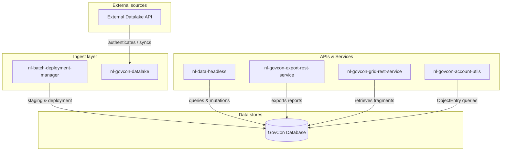

:::warning[INTERNAL]
This page is for engineering and operations. It documents internal services, extensions, and configurations without exposing credentials.
:::

## System overview

The GovCon360 database and backend architecture encompasses 4,527 total files across modular Java OSGi bundles. These components manage data headless services, REST export capabilities, batch deployments, grid services, datalake integrations, and common account utilities. 

## Components and extensions

The backend relies on modular OSGi services, portlets, and configuration interfaces distributed across several packages.

| Component / Class | Type | Friendly URL / Config | OAuth Scopes / Details |
| :--- | :--- | :--- | :--- |
| `BatchDeploymentConfiguration` | `INTERFACE` | `nl.batch.deployment.manager.configuration` | OCD interface for staging/deployment directories and import task limits. |
| `DatalakeConfiguration` | `INTERFACE` | `nl.govcon.datalake.configuration` | OCD interface managing OAuth client credentials and access token endpoints. |
| `ExportConfiguration` | `INTERFACE` | `nl.govcon.export.rest.service.internal.configurations` | OCD interface defining export limits (Excel, CSV, PDF) and email configurations. |
| `FragmentConfiguration` | `INTERFACE` | `nl.govcon.grid.rest.service.util` | OCD interface managing site IDs and fragment collection names. |
| `BatchDeploymentPanelApp` | `CLASS` | `nl.batch.deployment.manager.application.list` | OSGi Component managing portlet visibility and control panel integration. |
| `BatchDeploymentPortlet` | `CLASS` | `nl.batch.deployment.manager.portlet` | OSGi Component rendering deployment views and language JSON. |
| `ClientExtensionPackageService` | `CLASS` | `nl.batch.deployment.manager.service` | Handles package inventory, folder mapping, and client extension deployment logic. |
| `DeployPackageMVCResourceCommand` | `CLASS` | `nl.batch.deployment.manager.resource` | MVC Resource Command executing package deployments and mutation checks. |
| `GetImportTasksMVCResourceCommand` | `CLASS` | `nl.batch.deployment.manager.resource` | Serves recent import task execution JSON payloads. |
| `GetPackagesMVCResourceCommand` | `CLASS` | `nl.batch.deployment.manager.resource` | Retrieves available deployment packages and host metadata. |
| `ImportTaskService` | `CLASS` | `nl.batch.deployment.manager.service` | Manages retrieval of recent import task summaries based on configured limits. |
| `PackageInspector` | `CLASS` | `nl.batch.deployment.manager.service` | Inspects package builds, timestamps, and JSON configuration files. |
| `LocalObjectEntryQuery` | `CLASS` | `nl.govcon.account` | Executes object entry queries, text, number, and flag expressions for account data. |

## Data and integration points

The system integrates internal file staging directories with external API authentication endpoints and dynamic object entry queries.

**Batch Management**

- **Configuration Interface**: `BatchDeploymentConfiguration`
- **Staging & Deployment**: Managed via `ClientExtensionPackageService` and `PackageInspector` to process local package inventories and execute deployments safely.
- **Resource Commands**: `DeployPackageMVCResourceCommand`, `GetImportTasksMVCResourceCommand`, and `GetPackagesMVCResourceCommand` expose asynchronous resource endpoints for UI management.

**Datalake & Export**

- **Datalake Sync**: Configured through `DatalakeConfiguration`, handling secure client IDs, client secrets, grant types, and token retrieval URLs.
- **Export Service**: Governed by `ExportConfiguration` to enforce strict limits on CSV, Excel, and PDF generation volumes, preventing resource exhaustion during heavy database extractions.
