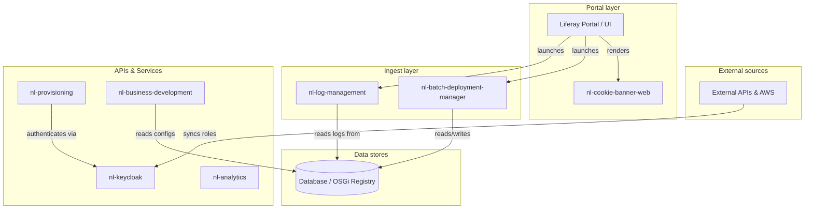

:::warning[INTERNAL]
This page is for engineering and operations. It documents internal services, extensions, and configurations without exposing credentials.
:::

## System overview

The GovCon360 infrastructure repository comprises 4,527 files, structured primarily around Liferay OSGi modules, Java backend services, provisioning engines, and log management tools. Core infrastructural capabilities include automated batch deployments, Keycloak OIDC authentication and synchronization, AWS provisioning integrations, analytic tracking, and specialized enterprise logging.

## Components and extensions

The table below documents the principal Java classes, interfaces, OSGi component definitions, and configuration interfaces discovered across the infrastructure modules.

| Component / Class | Type | Module | Details / Config PIDs |
| :--- | :--- | :--- | :--- |
| `GovConBillingConfigurationResource` | `CLASS` | `modules/commerce/govcon-billing-cron` | Provides REST endpoint for billing configuration retrieval (`@Path`). |
| `GovConBillingConfiguration` | `INTERFACE` | `modules/commerce/govcon-billing-cron` | OCD definition for billing cycle properties (`invoiceDueDays`, `invoiceLeadDays`). |
| `NlAnalyticsInstanceConfiguration` | `INTERFACE` | `modules/common/nl-analytics` | Global analytics instance settings (`enabled`, `gtmScriptHtml`). |
| `NlAnalyticsSiteConfiguration` | `INTERFACE` | `modules/common/nl-analytics` | Per-site Google Tag Manager parameters (`gtmEnabled`, `gtmId`). |
| `BatchDeploymentConfiguration` | `INTERFACE` | `modules/common/nl-batch-deployment-manager` | Directory and task limits for package staging (`stagingDirectory`, `deploymentDirectory`). |
| `EmailSenderConfiguration` | `INTERFACE` | `modules/common/nl-govcon-notification` | Notification rules (`allowedRoleNames`, `maxRecipients`, `maxAttachmentsSizeMB`). |
| `NlGovconNotificationConfiguration` | `INTERFACE` | `modules/common/nl-govcon-notification` | Core alert templates and support routing parameters. |
| `NotificationConfig` | `INTERFACE` | `modules/common/nl-govcon-notification` | Portlet view bindings and redirection target paths. |
| `ProvisioningJamesConfiguration` | `INTERFACE` | `modules/common/nl-james-service` | Apache James mail server connection and credential settings. |
| `NlKeycloakConfiguration` | `INTERFACE` | `modules/common/nl-keycloak` | OIDC / Keycloak server properties (`getServerUrl`, `getAdminRealm`, `getAdminClientId`). |
| `NlKeycloakRealmConfiguration` | `INTERFACE` | `modules/common/nl-keycloak` | Realm SMTP configuration and mail transport settings. |
| `RoleSyncConfiguration` | `INTERFACE` | `modules/common/nl-keycloak` | OIDC role synchronization mapping (`regularRoles`, `organizationRoles`). |
| `LogManagementConfiguration` | `INTERFACE` | `modules/common/nl-log-management` | Log path and preview constraints (`liferayHomeDirectory`, `defaultPreviewLines`). |
| `HomeURLFilterConfiguration` | `INTERFACE` | `modules/common/nl-login` | Default redirection URL specifications following session creation. |
| `LoginHistoryCleanupConfiguration` | `INTERFACE` | `modules/common/nl-login` | Retention scheduling parameters (`retentionDays`, `cronExpression`, `batchSize`). |
| `OidcLoginRedirectConfiguration` | `INTERFACE` | `modules/common/nl-login` | Single sign-on bypass rules and provider definitions. |
| `ProvisioningPostLoginConfiguration` | `INTERFACE` | `modules/common/nl-login` | Post-authentication redirect path configuration. |
| `B2BSsoProvisioningConfiguration` | `INTERFACE` | `modules/common/nl-provisioning` | Tenant-level environment and prefix configurations (`realmPrefix`, `clientPrefix`). |
| `GovConCommerceConfiguration` | `INTERFACE` | `modules/common/nl-provisioning` | Admin slot limits and overage eligibility toggles. |
| `GovConPaymentReminderConfiguration` | `INTERFACE` | `modules/common/nl-payment` | Automated billing reminder scheduling parameters. |
| `GovconOAuth2ScopeConfiguration` | `INTERFACE` | `modules/common/nl-provisioning` | Authorized OAuth2 scope definitions. |
| `ProvisioningAwsConfiguration` | `INTERFACE` | `modules/common/nl-provisioning` | AWS credentials and zone locators (`hostedZoneId`, `accessKey`, `secretKey`). |
| `ProvisioningKubernetesConfiguration` | `INTERFACE` | `modules/common/nl-provisioning` | Ingress and service descriptors (`namespace`, `ingressName`, `servicePort`). |
| `SharedRealmProvisioningConfiguration` | `INTERFACE` | `modules/common/nl-provisioning` | Centralized realm bootstrap parameters (`portalUrl`, `administratorEmail`). |
| `AccountRelationshipEnrichmentConfiguration` | `INTERFACE` | `modules/govcon360/nl-business-development` | API cache and timeout parameters for account enrichment. |
| `CapabilityConfiguration` | `INTERFACE` | `modules/govcon360/nl-business-development` | Lead capability synchronization retry intervals and timeouts. |
| `ContactEnrichmentConfiguration` | `INTERFACE` | `modules/govcon360/nl-business-development` | Contact sync cache rules and API thresholds. |
| `EnrichmentConfiguration` | `INTERFACE` | `modules/govcon360/nl-business-development` | Recompete refresh intervals for headless business development. |
| `ProcurementNoticeEnrichmentConfiguration` | `INTERFACE` | `modules/govcon360/nl-business-development` | SAM.gov / procurement notice detail caching configurations. |
| `ProspectorCountsConfiguration` | `INTERFACE` | `modules/govcon360/nl-business-development` | Lead finder filter and date window defaults (`newLeadsDays`, `samGovDays`). |
| `RecompeteEnrichmentConfiguration` | `INTERFACE` | `modules/govcon360/nl-business-development` | Recompete data freshness and API timeout rules. |
| `SamGovEnrichmentConfiguration` | `INTERFACE` | `modules/govcon360/nl-business-development` | SAM.gov federal data integration parameters. |
| `APIGatewayConfiguration` | `INTERFACE` | `modules/govcon360/nl-govcon-api-helper` | External gateway connectivity (`getAccessTokenUrl`, `getClientId`, `getGrantType`). |
| `DatalakeConfiguration` | `INTERFACE` | `modules/govcon360/nl-govcon-datalake` | Enterprise data lake authentication configurations. |
| `ExportConfiguration` | `INTERFACE` | `modules/govcon360/nl-govcon-export-rest-service` | Export thresholds and formats (`maxExportLimitForExcel`, `isCsvExportEnable`). |
| `FragmentConfiguration` | `INTERFACE` | `modules/govcon360/nl-govcon-grid-rest-service` | Site ID and fragment collection bindings (`getSiteId`, `getFragmentCollectionName`). |
| `GovConMetaTagCompanyConfiguration` | `INTERFACE` | `modules/govcon360/nl-govcon-layout-provider` | Metadata and object definition mapping (`metaTagObjectDefinitionERC`). |
| `GovConRouteGroupConfiguration` | `INTERFACE` | `modules/govcon360/nl-govcon-layout-provider` | Entity route aliases and friendly URL mapping rules. |
| `DynamicSitemapEntityConfiguration` | `INTERFACE` | `modules/marketing-accelerator/nl-marketing-accelerator` | Sitemap generation entity definitions (`apiEndpoint`, `payload`, `idField`). |
| `SitemapConfiguration` | `INTERFACE` | `modules/marketing-accelerator/nl-marketing-accelerator` | Document folder ID and document compression limits for sitemaps. |

## Data and integration points

The infrastructure modules rely on several structured interaction boundaries:

- **Batch Deployment Pipelines**: Managed via `ClientExtensionPackageService` and `PackageInspector` within `nl-batch-deployment-manager`. Packages are evaluated, staged, and tracked for import status reporting.
- **Keycloak & OIDC Security Layer**: Implemented through `NlKeycloakConfiguration` and `RoleSyncConfiguration`. This layer governs cross-tenant single sign-on provisioning, role synchronization (`regularRoles` and `organizationRoles`), and SMTP credential inheritance per realm.
- **AWS and Kubernetes Provisioning**: Orchestrated via `ProvisioningAwsConfiguration` and `ProvisioningKubernetesConfiguration`. These components manage route53 zones, elastic load balancers, and namespace routing for tenant environments.
- **Log Management and Diagnostics**: Powered by `LogDownloadMVCResourceCommand`, `LogRangeDownloadMVCResourceCommand`, and `LogManagementAccessChecker` in `nl-log-management`, allowing secure streaming and chunked file downloads directly from the Liferay home directory.
