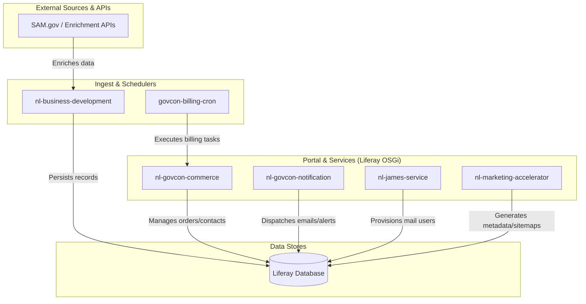

description: "Architecture reference and component inventory for GovCon360 integrations, headless services, and OSGi configurations."

:::warning[INTERNAL]
This page is for engineering and operations. It documents internal services, extensions, and configurations without exposing credentials.
:::

## System overview

The GovCon360 integration layer is structured around a modular OSGi architecture built for Liferay, comprising business development, marketing accelerators, commerce extensions, notification pipelines, and provisioning services. The codebase spans 4,527 total files across multiple functional modules, exposing custom REST endpoints, background schedulers, and configuration services.

## Components and extensions

### Commerce and Billing Modules

| Component | Type | Friendly URL / Config | OAuth Scopes / Details |
| :--- | :--- | :--- | :--- |
| `GovConBillingConfigurationResource` | REST Resource | `/govcon-billing/...` | `modules/commerce/govcon-billing-cron` |
| `DefaultCompanyBillingContactsResource` | REST Resource | Headless Delivery Order API | `nl.govcon.headless.commerce.delivery.order` |
| `DefaultCompanyBillingContractsResource` | REST Resource | Headless Delivery Order API | `nl.govcon.headless.commerce.delivery.order` |
| `PlacedOrderByExternalReferenceCodeResource` | REST Resource | Headless Delivery Order API | `nl.govcon.headless.commerce.delivery.order` |
| `GovConBillingDispatchTaskExecutor` | OSGi Scheduler | `com.govcon.billing.scheduler` | Dispatches recurring billing execution tasks |
| `InvoiceJob` | Batch Job | `com.govcon.billing.scheduler` | Generates invoices, processes Expando values, adds contacts |
| `GovConBillingConfiguration` | OSGi OCD | `com.govcon.billing.configuration` | Defines `invoiceDueDays()` and `invoiceLeadDays()` |

### Business Development & Enrichment

| Component | Type | Friendly URL / Config | OAuth Scopes / Details |
| :--- | :--- | :--- | :--- |
| `EnrichmentDebugResource` | REST Resource | `/enrichment/debug/...` | `nl.govcon.business.development.enrichment.debug` |
| `AccountRelationshipEnrichmentConfiguration` | OSGi OCD | `nl.govcon.business.development.accounts.enrichment` | Controls cache TTL, refresh intervals, and API timeouts |
| `ContactEnrichmentConfiguration` | OSGi OCD | `nl.govcon.business.development.contacts.enrichment` | Manages contact data synchronization parameters |
| `ProcurementNoticeEnrichmentConfiguration` | OSGi OCD | `nl.govcon.business.development.lead.procurementnotices.enrichment` | Governs notice caching and fetch intervals |
| `SamGovEnrichmentConfiguration` | OSGi OCD | `nl.govcon.business.development.lead.samgov.enrichment` | Manages SAM.gov integration thresholds |

### Notification and Messaging Services

| Component | Type | Friendly URL / Config | OAuth Scopes / Details |
| :--- | :--- | :--- | :--- |
| `EmailResourceImpl` | REST Resource | `/v1.0/email/...` | `nl.govcon.notification.rest.internal.resource.v1_0` |
| `NotificationResourceImpl` | REST Resource | `/v1.0/notifications/...` | `nl.govcon.notification.rest.internal.resource.v1_0` |
| `EmailSenderServiceImpl` | Service Component | `nl.govcon.notification.core.internal` | MimeMessage creation and SMTP delivery |
| `UserNotificationServiceImpl` | Service Component | `nl.govcon.notification.core.internal.user.notification` | Handles user-specific alerts and unread counts |
| `EmailSenderConfiguration` | OSGi OCD | `nl.govcon.notification.core.configuration` | Enforces sender address, roles, and attachment limits |

## Data and integration points

**Scheduled Jobs**

- **InvoiceJob (`govcon-billing-cron`)**: Executes scheduled billing cycles, evaluates customer orders, and persists state using Liferay Expando tables and JSON objects.
- **GovConBillingDispatchTaskExecutor**: Coordinates task distribution for billing operations across cluster nodes.

**External Enrichment APIs**

- **SAM.gov & Business Development APIs**: Integrated via modular configuration interfaces (`SamGovEnrichmentConfiguration`, `ProcurementNoticeEnrichmentConfiguration`). Features adjustable cache TTLs, API timeouts, and forced fallback options (`isAlwaysFetchFromApi`).
- **EnrichmentDebugResource**: Provides operational oversight, health checks, filter inspection, and API bypass controls for troubleshooting external sync failures.

**Provisioning & Mail**

- **JamesUserService (`nl-james-service`)**: Interfaces with Apache James mail server infrastructure to provision mailboxes using parameters defined in `ProvisioningJamesConfiguration`.
- **DefaultCompanyBillingContactsRequestFilter**: Intercepts headless commerce delivery requests to enforce company context and inject default administrative credentials.
